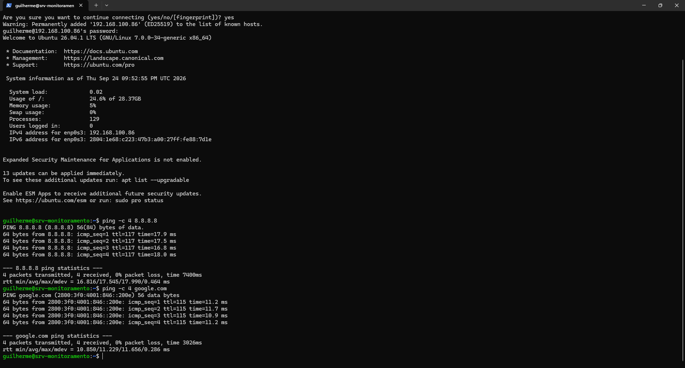
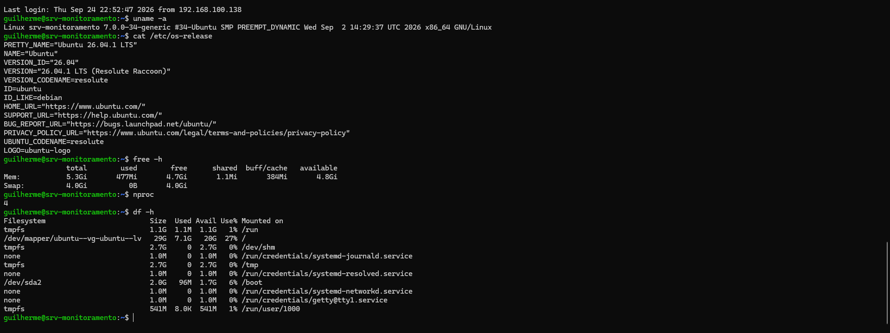
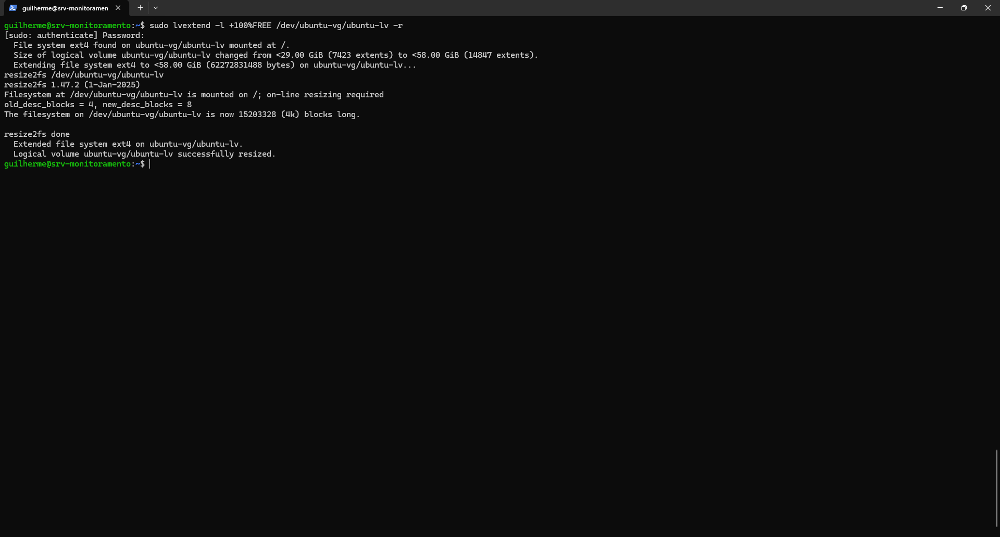
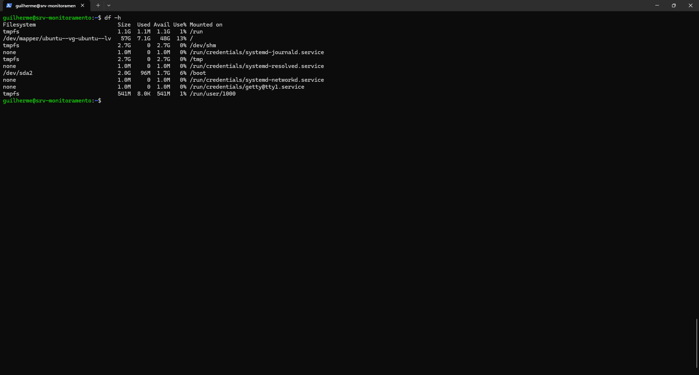
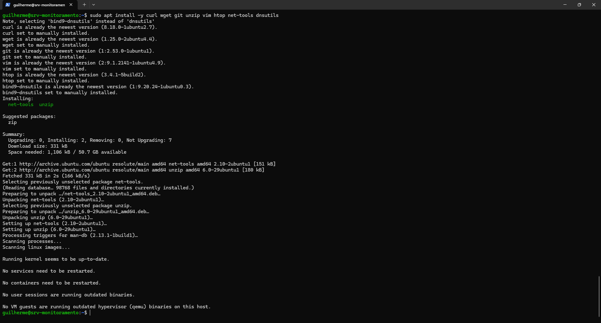
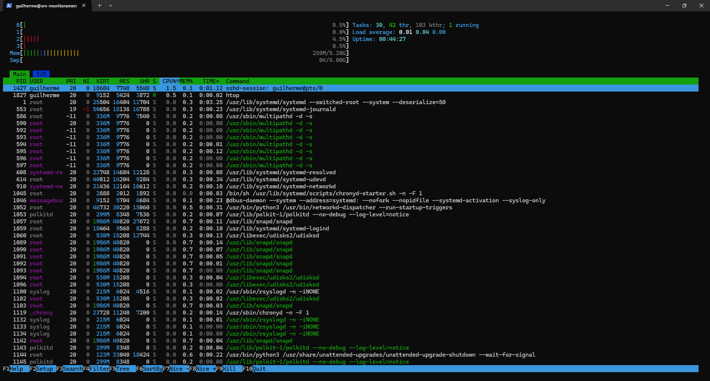

# Fase 1 — Servidor Ubuntu (SRV-MONITORAMENTO)

> **Objetivo:** criar a VM Linux que vai hospedar, na mesma máquina, o Zabbix, o Grafana e o GLPI, e deixá-la atualizada, acessível por SSH e com as ferramentas básicas de diagnóstico.

| Item | Valor |
| :--- | :--- |
| Hypervisor | Oracle VirtualBox |
| Sistema | Ubuntu Server 26.04.1 LTS (`resolute`) |
| Hostname | `srv-monitoramento` |
| Usuário | `guilherme` |
| IP | `192.168.100.86` (interface `enp0s3`) |
| Kernel nesta fase | `7.0.0-34-generic` |

**Por que uma única VM?** O computador host tem 16 GB de RAM e também precisa rodar as VMs do Projeto 1 (Windows Server e PC01). Concentrar os três serviços em uma VM de 6 GB evita gastar memória com três servidores separados.

---

## Etapa 1 — Criar a VM no VirtualBox

Configuração usada:

| Parâmetro | Valor |
| :--- | :--- |
| Nome | `SRV-MONITORAMENTO` |
| Tipo / Versão | Linux / Ubuntu (64-bit) |
| Memória RAM | 6144 MB (6 GB) |
| Processadores | 4 vCPUs |
| Disco | 60 GB, VDI, alocado dinamicamente |
| Rede | NAT na criação; depois bridge (veja a Etapa 3) |

> 6 GB deixam cerca de 10 GB para o Windows do host. O Grafana indica 2–4 GB de RAM como referência para instalações pequenas, e aqui ele divide a máquina com Zabbix, GLPI, MariaDB e Apache.

## Etapa 2 — Instalar o Ubuntu Server 26.04.1 LTS

Escolheu-se a edição **Server**, sem interface gráfica, para sobrar mais RAM aos serviços. Durante o instalador:

- **Hostname:** `srv-monitoramento`
- **Usuário:** `guilherme`
- **OpenSSH server:** marcado (`[X] Install OpenSSH server`), para administrar a VM remotamente.

## Etapa 3 — Primeiro acesso, rede e SSH

Dentro da VM, verificou-se o endereço IP:

```bash
ip addr
```

A VM foi colocada na mesma faixa de rede do computador host (`192.168.100.x`), e o servidor passou a responder em `192.168.100.86`. A partir daí, o acesso passou a ser feito pelo **PowerShell do Windows** via SSH:

```powershell
ssh guilherme@192.168.100.86
```

No primeiro acesso o SSH pede para confirmar a impressão digital (*fingerprint*) do servidor. Após `yes`, o host é gravado em `known_hosts` e o login com a senha do usuário funciona.

### Teste de conectividade (troubleshooting em duas camadas)

```bash
ping -c 4 8.8.8.8
ping -c 4 google.com
```

| Teste | O que valida | Resultado |
| :--- | :--- | :--- |
| `ping 8.8.8.8` | Conectividade IP com a internet | 4 enviados, 4 recebidos, 0% de perda, ~17,5 ms de média |
| `ping google.com` | Resolução de nomes (DNS) | 4 enviados, 4 recebidos, 0% de perda, ~11,2 ms de média |

Se o primeiro falhar, o problema é de rota/gateway. Se só o segundo falhar, o problema é de DNS. Essa separação é a mesma usada depois, na Fase 7, no incidente de conectividade externa.



## Etapa 4 — Atualizar o sistema

```bash
sudo apt update
sudo apt upgrade -y
sudo reboot
```

No login, o Ubuntu informava **13 atualizações pendentes**. Depois do `upgrade` e da reinicialização, o aviso mudou para **0 updates**.

Conferência após o reboot:

```bash
uname -a
cat /etc/os-release
```

Resultado: `Ubuntu 26.04.1 LTS (Resolute Raccoon)`, kernel `7.0.0-34-generic`.

## Etapa 5 — Conferir os recursos da VM

```bash
free -h
nproc
df -h
```

| Recurso | Esperado | Encontrado |
| :--- | :--- | :--- |
| RAM | ~6 GB | 5,3 GiB totais (o restante fica reservado pelo kernel/hardware virtual) |
| Swap | — | 4,0 GiB, sem uso |
| CPU | 4 | `nproc` = 4 |
| Disco | ~60 GB | **`/` com apenas 29 GB** |



### Problema encontrado: o disco de 60 GB não estava todo disponível

O instalador do Ubuntu com **LVM** criou o volume lógico raiz com ~29 GB e deixou o restante do disco sem alocação. Como o MariaDB (Zabbix e GLPI) e os históricos do monitoramento crescem com o tempo, o espaço foi estendido antes de instalar qualquer serviço:

```bash
sudo lvextend -l +100%FREE /dev/ubuntu-vg/ubuntu-lv -r
```

- `-l +100%FREE`: usa todo o espaço livre do grupo de volumes.
- `-r`: redimensiona o sistema de arquivos (ext4) em seguida, com o volume montado.

Saída relevante: `Size of logical volume ubuntu-vg/ubuntu-lv changed from <29.00 GiB (7423 extents) to <58.00 GiB (14847 extents)` e `resize2fs done`.



Conferência final com `df -h`: `/` passou para **57 GB, com 7,1 GB usados (13%)**.



## Etapa 6 — Instalar as ferramentas básicas

```bash
sudo apt install -y curl wget git unzip vim htop net-tools dnsutils
```

`curl`, `wget`, `git`, `vim`, `htop` e `dnsutils` (`bind9-dnsutils`) já estavam presentes. Foram instalados `net-tools` e `unzip`.



| Ferramenta | Uso no projeto |
| :--- | :--- |
| `curl` / `wget` | Testar URLs e baixar pacotes e repositórios |
| `git` | Versionar a documentação |
| `unzip` | Extrair o pacote do GLPI |
| `vim` | Editar arquivos de configuração |
| `htop` | Observar CPU, memória e processos |
| `net-tools` / `dnsutils` | `ifconfig`, `netstat`, `nslookup`, `dig` |

Para observar o servidor em repouso, abriu-se o `htop` (saída com **F10**). Valores de referência: ~259 MB de 5,28 GB de RAM usados, carga média 0,01 e swap em 0.



Para anotar o IP:

```bash
hostname -I
```

## Etapa 7 — Definir o papel do servidor

```text
Nome:      SRV-MONITORAMENTO
Função:    Servidor de Monitoramento + ITSM

                 SRV-MONITORAMENTO
                         │
          ┌──────────────┼──────────────┐
          │              │              │
       Zabbix         Grafana          GLPI
          │              │              │
          └──────────────┼──────────────┘
                         │
                      MariaDB
```

Serviços planejados: Zabbix Server, Zabbix Agent 2, Grafana, GLPI, MariaDB, Apache e PHP.

## Etapa 8 — Validação do servidor (antes de instalar os serviços)

```bash
systemctl --failed
systemctl status ssh
sudo ss -tulpn
```

| Comando | Resultado esperado |
| :--- | :--- |
| `systemctl --failed` | `0 loaded units listed.` |
| `systemctl status ssh` | `Active: active (running)` |
| `sudo ss -tulpn` | Porta 22 (SSH) escutando |

O `ss -tulpn` volta a ser usado nas fases seguintes para conferir as portas dos serviços: Zabbix Server (10051), Grafana (3000), Apache/GLPI (80) e SSH (22).

---

## ✅ Checklist da Fase 1

- [x] VM criada com 6 GB de RAM, 4 vCPUs e 60 GB de disco
- [x] Ubuntu Server 26.04.1 LTS instalado
- [x] Acesso SSH pelo PowerShell do Windows
- [x] Conectividade IP e DNS validadas
- [x] Sistema atualizado (13 → 0 atualizações pendentes)
- [x] Volume raiz estendido de 29 GB para 58 GB (LVM)
- [x] Ferramentas básicas de diagnóstico instaladas
- [x] Papel do servidor definido

## 🎓 O que esta fase demonstra

- Criação e dimensionamento de VM para um host com recursos limitados
- Administração remota com SSH
- Troubleshooting de rede em camadas (IP e DNS)
- Gerenciamento de pacotes com `apt`
- Leitura de consumo de recursos (`free`, `nproc`, `df`, `htop`)
- Gerenciamento de volumes LVM e redimensionamento de ext4 em produção, sem desmontar o disco

**Próxima fase:** [Fase 2 — Banco de dados (MariaDB)](fase-02-banco-de-dados.md)
