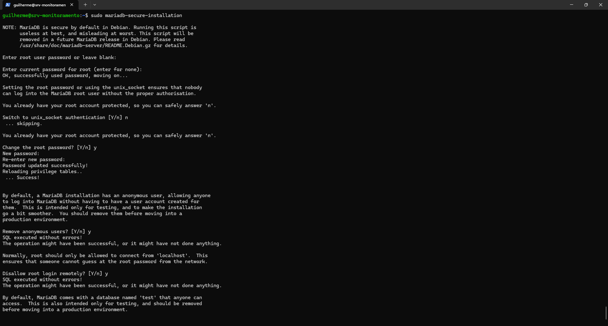
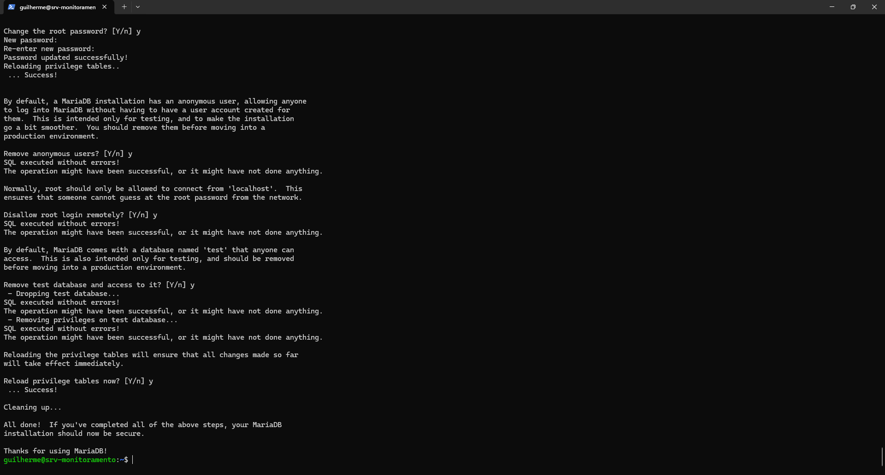

# Fase 2 — Banco de Dados (MariaDB)

> **Objetivo:** instalar uma única instância de MariaDB e preparar dois bancos separados, um para o Zabbix e outro para o GLPI, cada um com seu próprio usuário e acesso restrito ao próprio banco.

| Item | Valor |
| :--- | :--- |
| Servidor | MariaDB 11.8.6 (pacote do Ubuntu 26.04) |
| Bancos | `zabbix` e `glpi` |
| Usuários | `zabbix`@`localhost` e `glpi`@`localhost` |
| Acesso | Somente local, sem exposição do banco na rede |

## Arquitetura da fase

```text
              Ubuntu 26.04.1
                    │
                 MariaDB
                    │
          ┌─────────┴─────────┐
          │                   │
       zabbix               glpi
          │                   │
    usuário próprio      usuário próprio
          │                   │
      localhost           localhost
```

**Por que uma instância e dois bancos?** A VM tem 6 GB de RAM. Duas instâncias do MariaDB gastariam memória sem necessidade, e um único banco misturaria os dados das duas aplicações. Com dois bancos e dois usuários, cada aplicação só enxerga o que é dela (princípio do menor privilégio) e as aplicações **nunca usam o `root`**.

---

## Etapa 1 — Instalar o MariaDB

```bash
sudo apt update
sudo apt install -y mariadb-server mariadb-client
```

Verificação:

```bash
systemctl status mariadb
mariadb --version
```

Esperado: `Active: active (running)`. Versão encontrada: **11.8.6-MariaDB**.

## Etapa 2 — Iniciar com o sistema

```bash
sudo systemctl enable --now mariadb
systemctl is-enabled mariadb    # enabled
systemctl is-active mariadb     # active
```

## Etapa 3 — Hardening inicial

```bash
sudo mariadb-secure-installation
```

Respostas usadas:

| Pergunta | Resposta |
| :--- | :---: |
| Switch to unix_socket authentication | `n` |
| Change the root password | `y` (senha forte definida) |
| Remove anonymous users | `y` |
| Disallow root login remotely | `y` |
| Remove test database and access to it | `y` |
| Reload privilege tables now | `y` |

O resultado final foi `All done! ... your MariaDB installation should now be secure.`




> **Observação:** a própria ferramenta avisa que, no Debian/Ubuntu, o MariaDB já é seguro por padrão e que o script será removido no futuro. Mesmo assim, ele serve para conferir a remoção de usuários anônimos, do banco `test` e do login remoto do root.

## Etapa 4 — Criar os bancos e usuários

Entrada no console como administrador:

```bash
sudo mariadb -u root -p
```

### Banco do Zabbix

```sql
CREATE DATABASE zabbix CHARACTER SET utf8mb4 COLLATE utf8mb4_bin;
CREATE USER 'zabbix'@'localhost' IDENTIFIED BY '<SENHA_FORTE_1>';
GRANT ALL PRIVILEGES ON zabbix.* TO 'zabbix'@'localhost';
```

`utf8mb4` com `utf8mb4_bin` é a combinação que a documentação do Zabbix recomenda para novas bases em MariaDB.

### Banco do GLPI

```sql
CREATE DATABASE glpi CHARACTER SET utf8mb4 COLLATE utf8mb4_unicode_ci;
CREATE USER 'glpi'@'localhost' IDENTIFIED BY '<SENHA_FORTE_2>';
GRANT ALL PRIVILEGES ON glpi.* TO 'glpi'@'localhost';
```

### Aplicar e sair

```sql
FLUSH PRIVILEGES;
EXIT;
```

> Cada usuário recebe privilégios **apenas no próprio banco** (`zabbix.*` ou `glpi.*`). Nenhum dos dois consegue ler o banco do outro.

## Etapa 5 — Testar o acesso de cada usuário

```bash
mariadb -u zabbix -p zabbix
```

```sql
SELECT DATABASE();    -- zabbix
EXIT;
```

```bash
mariadb -u glpi -p glpi
```

```sql
SELECT DATABASE();    -- glpi
EXIT;
```

Os dois logins funcionaram, o que confirma que os usuários e as senhas estão corretos antes de instalar as aplicações.

## Etapa 6 — Fuso horário para o GLPI

O GLPI usa as tabelas de fuso horário do MariaDB. Elas são carregadas assim:

```bash
sudo mariadb-tzinfo-to-sql /usr/share/zoneinfo | sudo mariadb mysql
```

E o usuário do GLPI recebe leitura **somente** nessa tabela:

```sql
GRANT SELECT ON mysql.time_zone_name TO 'glpi'@'localhost';
FLUSH PRIVILEGES;
```

## Etapa 7 — Verificar o resultado

```bash
sudo mariadb -e "SHOW DATABASES;"
sudo mariadb -e "SHOW GRANTS FOR 'zabbix'@'localhost';"
sudo mariadb -e "SHOW GRANTS FOR 'glpi'@'localhost';"
```

Esperado: os bancos `zabbix` e `glpi` na lista, cada usuário com permissão apenas no seu banco (o `glpi` também com `SELECT` em `mysql.time_zone_name`).

## Etapa 8 — Conferir que o banco não está exposto na rede

Como Zabbix e GLPI estão na mesma VM, não há motivo para o MariaDB aceitar conexões de fora:

```bash
sudo mariadb -e "SHOW VARIABLES LIKE 'bind_address';"
sudo ss -lntp | grep 3306
```

| Resultado | Significado |
| :--- | :--- |
| `127.0.0.1:3306` | Seguro: só a própria VM acessa o banco |
| `0.0.0.0:3306` | Exposto: o banco escuta toda a rede |

Resultado obtido: `bind_address = 127.0.0.1` e `LISTEN 127.0.0.1:3306` no `ss`, ou seja, **o banco escuta apenas localmente**. O `SHOW DATABASES` listou `glpi`, `zabbix` e os bancos do sistema (`information_schema`, `mysql`, `performance_schema`, `sys`).

---

## ⚠️ Problemas encontrados

### 1. Comandos repetidos e erros inofensivos

Os comandos de criação foram executados duas vezes seguidas, a segunda dentro de um bloco único com os dois bancos. A segunda rodada retornou:

```text
ERROR 1007 (HY000): Can't create database 'zabbix'; database exists
ERROR 1396 (HY000): Operation CREATE USER failed for 'zabbix'@'localhost'
```

Não houve dano: o banco e o usuário já existiam, e o `GRANT` e o `FLUSH PRIVILEGES` são repetíveis. O aprendizado é escrever esses scripts de forma que possam rodar mais de uma vez:

```sql
CREATE DATABASE IF NOT EXISTS zabbix CHARACTER SET utf8mb4 COLLATE utf8mb4_bin;
CREATE USER IF NOT EXISTS 'zabbix'@'localhost' IDENTIFIED BY '<SENHA_FORTE_1>';
```

### 2. MariaDB não iniciou após definir o fuso horário padrão

Ao tentar fixar o fuso do servidor no arquivo `/etc/mysql/mariadb.conf.d/50-server.cnf`, com `default-time-zone = 'America/Sao_Paulo'`, o serviço deixou de subir. O `journalctl -xeu mariadb` mostrou:

```text
[ERROR] Fatal error: Illegal or unknown default time zone 'America/Sao_Paulo'
[ERROR] Aborting
mariadb.service: Main process exited, code=exited, status=1/FAILURE
```

O MariaDB só aceita um fuso por nome depois que as tabelas de fuso horário estão carregadas (Etapa 6). Com o arquivo corrigido e o serviço reiniciado, o banco voltou a funcionar. Além disso, o `systemctl` avisou `The unit file ... changed on disk`, resolvido com `sudo systemctl daemon-reload`.

> **Lição:** uma linha inválida em um arquivo de configuração impede o serviço de iniciar. Depois de editar, sempre rode `systemctl restart` e confira o `status` ou o `journalctl` antes de seguir.

### 3. Boas práticas de senha

Na primeira passada, a mesma senha foi usada para os dois usuários de banco. O correto é **uma senha diferente para cada usuário**, e nunca registrar senhas em capturas ou em arquivos versionados. Para trocar sem recriar nada:

```sql
ALTER USER 'zabbix'@'localhost' IDENTIFIED BY '<NOVA_SENHA_1>';
ALTER USER 'glpi'@'localhost'   IDENTIFIED BY '<NOVA_SENHA_2>';
FLUSH PRIVILEGES;
```

Depois da troca, é preciso atualizar a senha onde cada aplicação a guarda: `DBPassword` em `/etc/zabbix/zabbix_server.conf` (Zabbix) e a configuração do banco do GLPI.

---

## ✅ Checklist da Fase 2

- [x] MariaDB 11.8.6 instalado, ativo e iniciando com o sistema
- [x] Hardening inicial com `mariadb-secure-installation`
- [x] Banco `zabbix` (`utf8mb4_bin`) e usuário próprio
- [x] Banco `glpi` (`utf8mb4_unicode_ci`) e usuário próprio
- [x] Acesso dos dois usuários testado
- [x] Tabelas de fuso horário carregadas para o GLPI
- [x] Porta 3306 restrita a `127.0.0.1` (confirmado com `ss -lntp`)

## 🎓 O que esta fase demonstra

- Instalação e administração de banco de dados em Linux
- Criação de bancos, usuários e permissões em SQL
- Princípio do menor privilégio na prática
- Hardening básico e redução da superfície de ataque
- Escolha correta de charset e collation conforme a documentação de cada produto
- Postura de segurança com credenciais

**Próxima fase:** Fase 3 — Zabbix.
