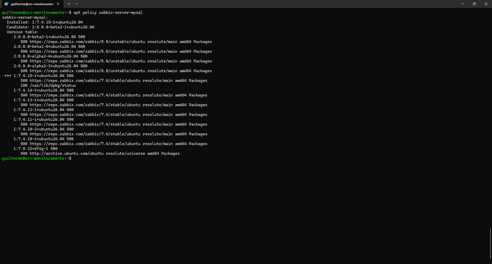
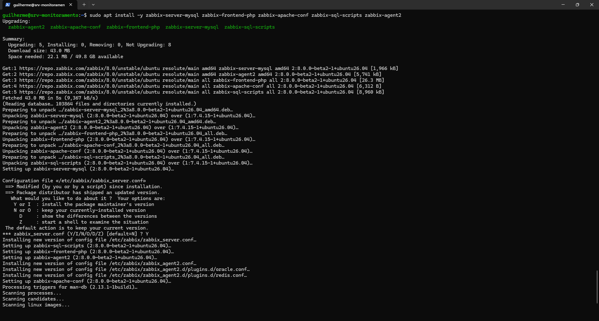
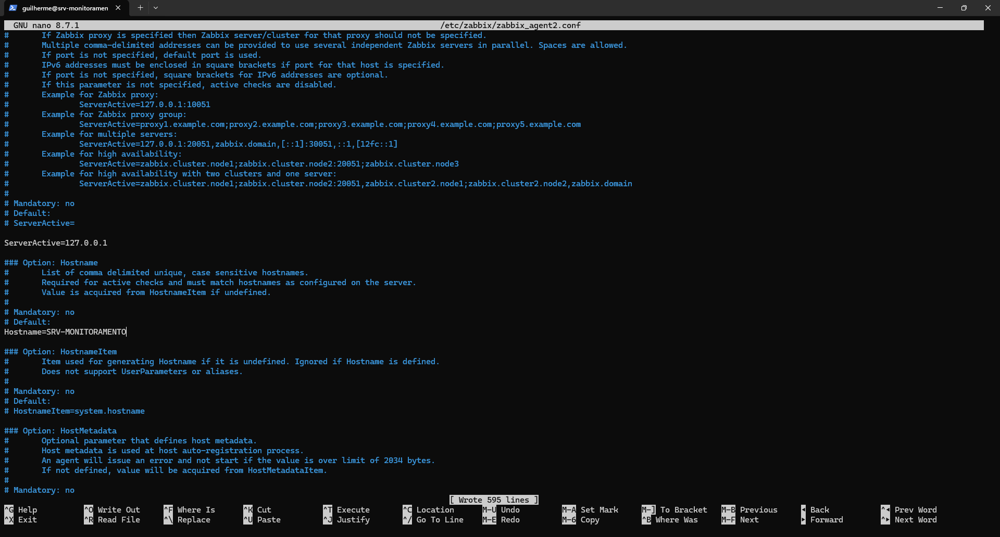
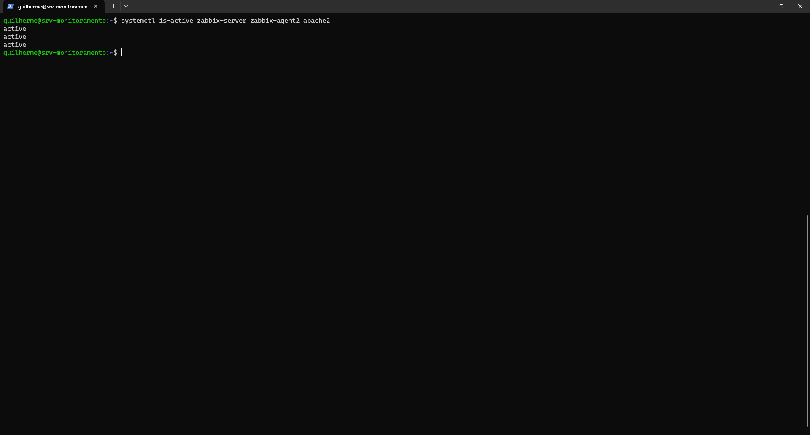
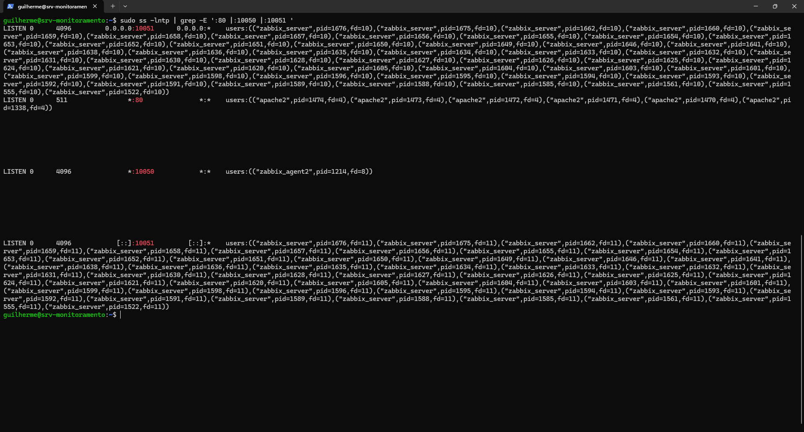
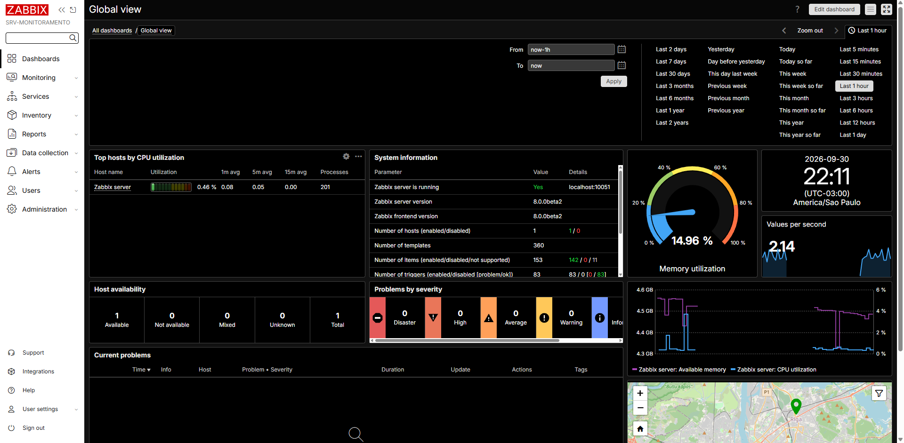
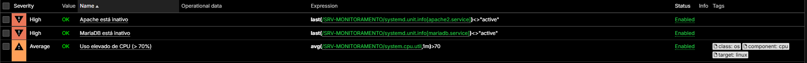

# Fase 3 — Zabbix (servidor, agente e primeiro host monitorado)

> **Objetivo:** instalar o Zabbix Server, o Agent 2 e o frontend web na VM, cadastrar o próprio servidor como host monitorado e validar CPU, memória, disco, rede e serviços, com triggers e falhas controladas para provar que os alertas funcionam.

| Item | Valor |
| :--- | :--- |
| Zabbix Server / Frontend | **8.0.0beta2** (pré-lançamento) |
| Zabbix Agent 2 | 8.0.0beta2 |
| Banco | MariaDB, banco `zabbix` (Fase 2) |
| Web | Apache 2 em `http://192.168.100.86/zabbix/` |
| Host monitorado | `SRV-MONITORAMENTO` (checks ativos) |
| Templates | `Linux by Zabbix agent active` e `Systemd by Zabbix agent 2` |
| Período | 28/09 a 07/10/2026 |

## Arquitetura da fase

```text
        Navegador
            │  http :80
        ┌───▼────┐
        │ Apache │── Frontend PHP (/zabbix)
        └───┬────┘
            │
   ┌────────▼─────────┐   :10051    ┌──────────────┐
   │  Zabbix Server   │◄────────────│ Zabbix Agent2│
   └────────┬─────────┘  checks     │  (:10050)    │
            │            ativos     └──────────────┘
        ┌───▼────┐
        │MariaDB │ banco "zabbix"
        └────────┘
```

---

## Planejado x executado

O plano era instalar o **Zabbix 7.4**. O que aconteceu foi diferente, e vale registrar:

| Data | Evento |
| :--- | :--- |
| 28/09 | Instalação com o repositório do **7.4** e importação do esquema do banco |
| 29/09 | Agent 2 funcionando (7.4.15), mas o `zabbix-server` falhava ao iniciar; Apache preparado e assistente web concluído |
| 30/09 | Adicionado o repositório do **8.0** e executado `apt install` dos mesmos pacotes: o `apt` os **atualizou** de 7.4.15 para **8.0.0~beta2** |
| 30/09 | Servidor 8.0 migrou o banco, houve erro de senha e de login, tudo corrigido; Global view abriu |
| 01/10 a 07/10 | Host, métricas, testes e triggers |

O 8.0 ainda não tinha versão final para Ubuntu 26.04, então o único pacote disponível no repositório `8.0` era o beta do ramo `unstable`. Por isso a versão instalada é pré-lançamento.

---

## Etapa 1 — Repositório e pacotes

Repositório oficial do 8.0 (Ubuntu 26.04, `resolute`):

```bash
wget https://repo.zabbix.com/zabbix/8.0/release/ubuntu/pool/main/z/zabbix-release/zabbix-release_latest+ubuntu26.04_all.deb
sudo dpkg -i zabbix-release_latest+ubuntu26.04_all.deb
sudo apt update
apt policy zabbix-server-mysql
```

O `apt policy` mostrou a versão instalada (7.4.15) e o candidato **`2:8.0.0~beta2`**, vindo de `repo.zabbix.com/zabbix/8.0/unstable`.



Instalação dos componentes:

```bash
sudo apt install -y zabbix-server-mysql zabbix-frontend-php zabbix-apache-conf zabbix-sql-scripts zabbix-agent2
```

A saída mostrou **`Upgrading: 5`**, ou seja, uma atualização dos cinco pacotes, e não uma instalação nova. Como o arquivo `zabbix_server.conf` já tinha sido alterado, o `dpkg` abriu o aviso *"Configuration file ... Modified (by you or by a script) since installation"*, e a opção escolhida (`Y`) substituiu o arquivo pela versão do pacote.



| Pacote | Função |
| :--- | :--- |
| `zabbix-server-mysql` | Servidor |
| `zabbix-agent2` | Agente |
| `zabbix-frontend-php` | Interface web |
| `zabbix-apache-conf` | Configuração do Apache |
| `zabbix-sql-scripts` | Esquema inicial do banco |

## Etapa 2 — Importar o esquema do banco

O caminho do script não era o que o roteiro indicava. `ls` falhou em `/usr/share/zabbix-sql-scripts/...`, e o `dpkg -L` mostrou o caminho real:

```bash
dpkg -L zabbix-sql-scripts | grep server.sql.gz
# /usr/share/zabbix/sql-scripts/mysql/server.sql.gz

zcat /usr/share/zabbix/sql-scripts/mysql/server.sql.gz | mariadb --default-character-set=utf8mb4 -u zabbix -p zabbix
```

Dica: use `dpkg -L <pacote>` para descobrir onde um pacote gravou seus arquivos, em vez de supor o caminho.

Depois, `SHOW TABLES;` no banco `zabbix` confirmou as tabelas (`acknowledges`, `actions`, `alerts`, `auditlog`, `history`, entre outras).

## Etapa 3 — Configurar o Server e o Agent 2

**Servidor** (`/etc/zabbix/zabbix_server.conf`): definir `DBPassword` com a senha do usuário `zabbix` do banco.

**Agente** (`/etc/zabbix/zabbix_agent2.conf`): usado em modo ativo, com `ServerActive` apontando para o próprio servidor e o `Hostname` igual ao cadastrado no frontend:

```ini
ServerActive=127.0.0.1
Hostname=SRV-MONITORAMENTO
```

> O `Hostname` diferencia maiúsculas de minúsculas e precisa ser **idêntico** ao nome do host no Zabbix. A linha vem comentada com `#` e é preciso remover o `#`. Enquanto isso não foi feito, o log do agente mostrou `hostname: [Zabbix server]`.



## Etapa 4 — Iniciar os serviços e conferir portas

```bash
sudo systemctl enable --now zabbix-server zabbix-agent2 apache2
systemctl is-active zabbix-server zabbix-agent2 apache2
sudo ss -lntp | grep -E ':80 |:10050 |:10051 '
```



| Porta | Serviço |
| :---: | :--- |
| 80 | Apache (frontend) |
| 10050 | Zabbix Agent 2 |
| 10051 | Zabbix Server |



## Etapa 5 — Assistente web e primeiro login

Em `http://192.168.100.86/zabbix/`, o assistente pediu o tipo de banco (MySQL/MariaDB), o host `localhost`, o banco `zabbix` e o usuário `zabbix`. O frontend grava essas credenciais em **`/etc/zabbix/web/zabbix.conf.php`**.

Após o login (`Admin`), o **Global view** confirmou:

- Zabbix server is running: **Yes**
- Zabbix server version / frontend version: **8.0.0beta2**
- 1 host disponível, 360 templates



## Etapa 6 — Cadastrar o host `SRV-MONITORAMENTO`

O host padrão `Zabbix server` usava checks passivos. Foi criado um host novo, com **checks ativos**, e o antigo foi desativado (**Disable**).

| Campo | Valor |
| :--- | :--- |
| Nome | `SRV-MONITORAMENTO` |
| Templates | `Linux by Zabbix agent active` e `Systemd by Zabbix agent 2` |
| Interface | Agent `127.0.0.1:10050` |

> A interface Agent é exigida pelo template Systemd para a descoberta automática (LLD) funcionar, mesmo com os dados coletados em modo ativo.

Depois de reiniciar o agente (`sudo systemctl restart zabbix-agent2`), o host passou a enviar dados: **259 itens** no primeiro momento e **278 itens** depois da descoberta dos serviços. O reinício também gerou o alerta informativo `Systemd: zabbix-agent2.service has been restarted (uptime < 10m)`, o primeiro sinal de que a detecção funcionava.

## Etapa 7 — Validar as métricas

Em **Monitoring → Latest data**:

| Métrica | Observação |
| :--- | :--- |
| CPU | `CPU utilization` em ~0,1% a 3% em repouso |
| Memória | Total **5,28 GB**, disponível ~**4,47 GB** (~85%) |
| Disco | Sistemas de arquivos descobertos por LLD, incluindo `FS [/]: Space: Used, in %` |
| Rede | Interface `enp0s3` **up**, 1 Gbps, com bits recebidos e enviados |
| Serviços | `apache2.service`, `mariadb.service` e `zabbix-server.service` descobertos pelo template Systemd |

> Dica de uso: se a tela de Latest data mostrar poucos itens, confira o filtro. Texto em **Name** limita os itens ao nome (por exemplo, `Zabbix server` escondia as outras 300 métricas), enquanto o host deve ser escolhido em **Hosts**.

## Etapa 8 — Testes de carga controlados (CPU)

**1ª tentativa (falhou de forma útil).** `stress-ng --cpu $(nproc) --timeout 60s` usa os **4** núcleos a 100%. A VM ficou sem responder: o Zabbix web parou, a sessão SSH caiu (`Connection reset`/`timed out`), e foi preciso esperar a recuperação. A causa é a VM e os serviços (Apache, MariaDB, Zabbix) dividirem as mesmas 4 vCPUs.

**2ª tentativa (controlada).** Carga limitada a 2 núcleos, a 70%, por 45 s:

```bash
stress-ng --cpu 2 --cpu-load 70 --timeout 45s
```

Resultado: `successful run completed in 45.03 secs`, sessão SSH mantida, e a curva de **CPU utilization** subiu de ~3% para mais de **13%** no Latest data.

> **Lição:** teste de carga em VM que hospeda o próprio monitoramento exige limitar núcleos e tempo, ou ele derruba a ferramenta que deveria medir. Foi também um dos primeiros sinais da instabilidade da VM registrada no README.

## Etapa 9 — Itens, triggers e falhas simuladas

### Item manual de serviço

| Campo | Valor |
| :--- | :--- |
| Name | `Status do Apache` |
| Type | Zabbix agent (active) |
| Key | `systemd.unit.info[apache2.service]` |
| Type of information | Text |

Itens equivalentes foram criados para o MariaDB e o Zabbix Server.

### Triggers criadas

| Nome | Severidade | Expressão |
| :--- | :---: | :--- |
| `Apache está inativo` | High | `last(/SRV-MONITORAMENTO/systemd.unit.info[apache2.service])<>"active"` |
| `MariaDB está inativo` | High | `last(/SRV-MONITORAMENTO/systemd.unit.info[mariadb.service])<>"active"` |
| `Uso elevado de CPU (> 70%)` | Average | `avg(/SRV-MONITORAMENTO/system.cpu.util,1m)>70` |



O host tem **102 triggers** habilitadas: as 3 acima são as criadas manualmente; as demais vêm dos templates (sistemas de arquivos `/` e `/boot`, interface `enp0s3`, memória, swap, carga, serviços systemd).

### Teste de falha: parar o Apache

```bash
sudo systemctl stop apache2     # simula a queda
# Monitoring → Problems: alerta em ~30-60 s
sudo systemctl start apache2    # recuperação
```

Resultado: o Zabbix registrou `apache2.service: Service is not running` (severidade Warning), e o navegador exibiu `ERR_CONNECTION_REFUSED`, porque o frontend do Zabbix é servido pelo próprio Apache. Ao religar o serviço, o problema foi resolvido sozinho (**Resolved**) e ficou no histórico.

### Teste de falha: parar o MariaDB

Ao parar o MariaDB, o **próprio Zabbix Server encerrou**, por perder o banco, e a tela Problems deixou de atualizar. Foi preciso reiniciar `mariadb` e depois `zabbix-server`.

> **Limitação de projeto:** com Zabbix e banco na mesma VM, a queda do banco não gera alerta, porque o que alertaria também cai. Em produção isso se resolve com monitoramento externo (por exemplo, um segundo servidor ou verificação de um *proxy*).

---

## ⚠️ Problemas encontrados e como foram resolvidos

| # | Problema | Causa | Solução |
| :-: | :--- | :--- | :--- |
| 1 | `zabbix-server` em loop de reinício (`status=1/FAILURE`) no 7.4 | `DBPassword` ausente ou incorreto em `zabbix_server.conf` (o resumo da conversa registra esse arquivo como "corrigido (DBPassword)") | Ajustar `DBPassword` para a senha do usuário `zabbix` e reiniciar o serviço |
| 2 | Interface com erro sobre versão do banco após ir para o 8.0 | Banco ainda no esquema do 7.4; o servidor 8.0 migra ao iniciar | Fazer o servidor 8.0 iniciar |
| 3 | `[1045] Access denied for user 'zabbix'@'localhost'` | Durante o `apt install`, o `dpkg` perguntou o que fazer com o `/etc/zabbix/zabbix_server.conf` modificado; a opção `Y` instalou o arquivo do pacote e o `DBPassword` configurado antes foi perdido | Redefinir a senha do usuário no banco e alinhar o `DBPassword` em `zabbix_server.conf` |
| 4 | Frontend ainda sem acesso ao banco | O frontend tem arquivo próprio de configuração | Editar **`/etc/zabbix/web/zabbix.conf.php`** (o caminho `/etc/zabbix/zabbix.conf.php` abre arquivo vazio) |
| 5 | Login `Admin` recusado | O 8.0 exige hash **bcrypt**; o hash antigo (MD5) não vale | Gerar o hash bcrypt com PHP e atualizar a tabela `users` por um script PDO |
| 6 | `Incorrect value for 'contents_width' field` no dashboard | Bug de validação conhecido da versão beta | `Ctrl+F5` e recriar o dashboard |
| 7 | VM travou no `stress-ng` com 4 núcleos | Saturação das 4 vCPUs compartilhadas | Teste limitado a 2 núcleos, 70%, 45 s |

---

## ✅ Checklist da Fase 3

- [x] Repositório oficial do Zabbix 8.0 adicionado
- [x] Server, Agent 2 e frontend instalados (8.0.0beta2)
- [x] Esquema do banco importado e migrado
- [x] Serviços ativos e portas 80, 10050 e 10051 conferidas
- [x] Assistente web concluído e login funcionando
- [x] Host `SRV-MONITORAMENTO` com checks ativos e dois templates
- [x] CPU, memória, disco, rede e serviços validados
- [x] Triggers de Apache, MariaDB e CPU criadas
- [x] Falha do Apache simulada: alerta e recuperação confirmados

## 🎓 O que esta fase demonstra

- Instalação de uma stack de monitoramento (Server, Agent, frontend, banco, web)
- Gerenciamento de versões e repositórios com `apt` (`apt policy`, atualização de pacotes)
- Diagnóstico de falhas de autenticação, de serviço e de configuração
- Monitoramento ativo, templates, descoberta automática (LLD) e triggers
- Testes de falha controlados e leitura de alertas e recuperação
- Consciência dos limites do próprio desenho (banco e monitor na mesma VM)

**Próxima fase:** Fase 4 — Grafana.
