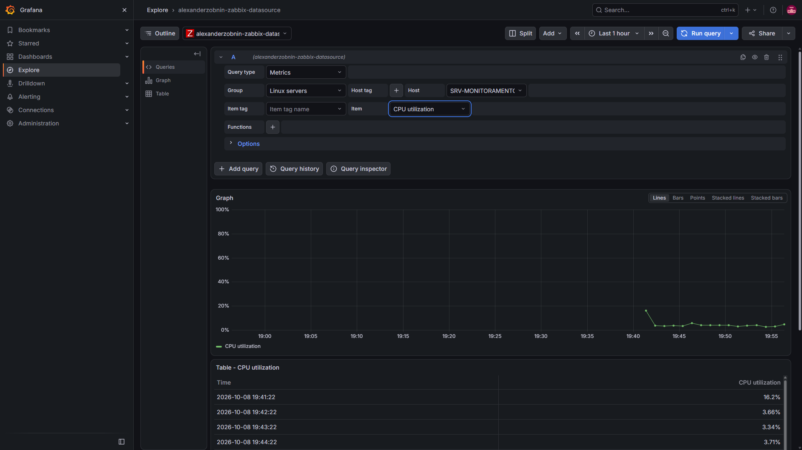
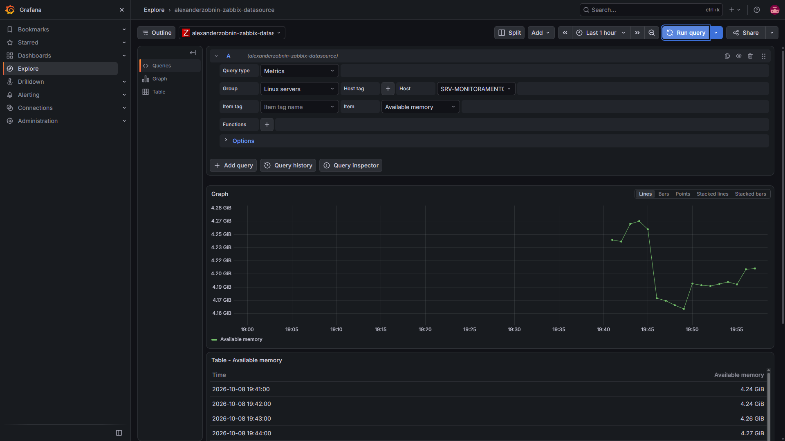
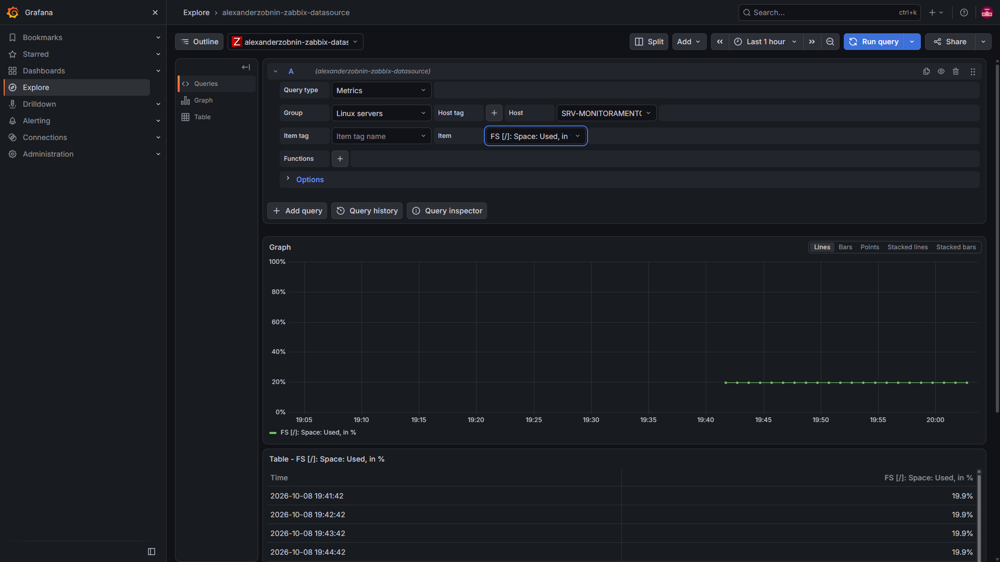
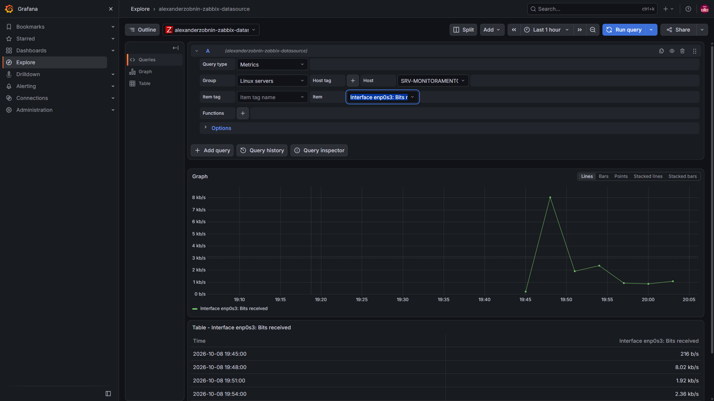
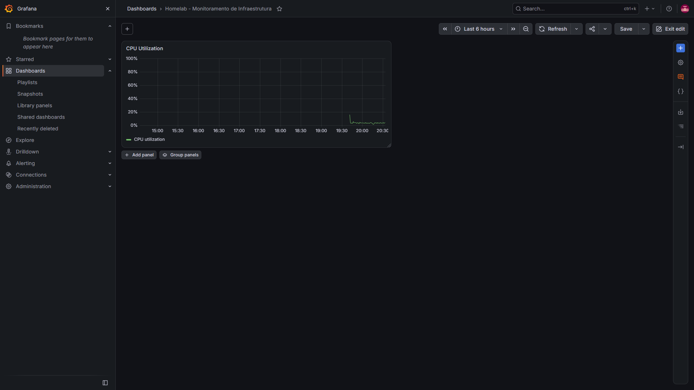
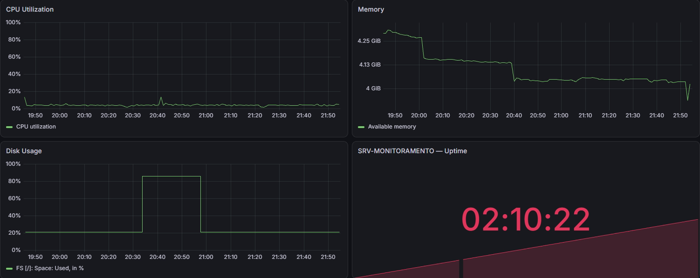
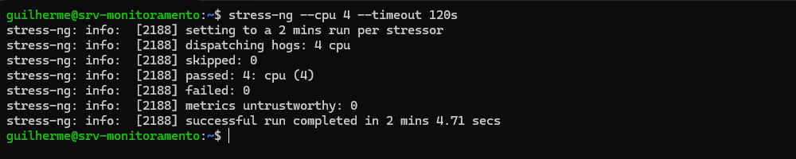
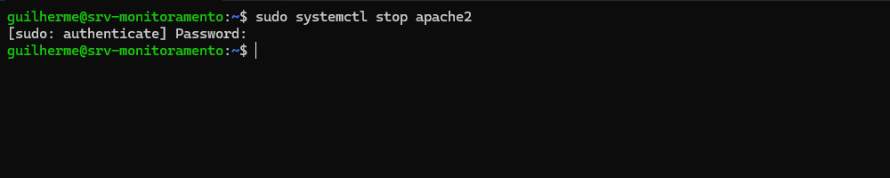
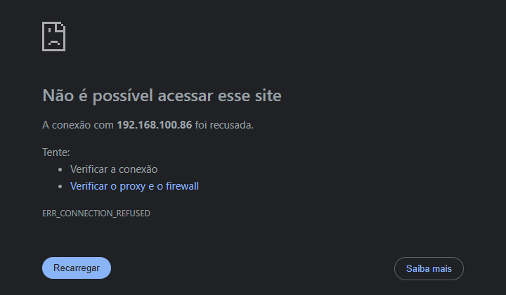
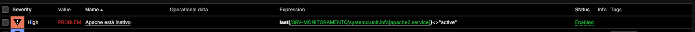

# Fase 4 — Grafana (visualização e dashboard)

> **Objetivo:** instalar o Grafana na mesma VM, conectá-lo ao Zabbix pelo plugin oficial, validar as métricas no **Explore** e montar o dashboard **Homelab - Monitoramento de Infraestrutura**, com testes reais de carga e de falha de serviço.

| Item | Valor |
| :--- | :--- |
| Grafana OSS | **13.2.3** (repositório APT oficial) |
| Plugin | Zabbix (`alexanderzobnin-zabbix-app`) **6.3.1** (instalado primeiro na 6.9.1; ver Problemas, item 2) |
| Fonte de dados | `alexanderzobnin-zabbix-datasource` (API do Zabbix) |
| Acesso | `http://192.168.100.86:3000` |
| Zabbix | 8.0.0beta2, API em `http://192.168.100.86/zabbix/api_jsonrpc.php` |
| Dashboard | `Homelab - Monitoramento de Infraestrutura` |
| Período | 06/10 a 12/10/2026 |

## Arquitetura da fase

```text
   Navegador ──http :3000──► Grafana 13.2.3
                                │  plugin Zabbix       
                                │  consultas JSON-RPC
                                ▼
                      Apache ──► /zabbix/api_jsonrpc.php
                                │
                         Zabbix Server ──► MariaDB (banco "zabbix")
```

O Grafana não coleta nada: ele consulta a API do Zabbix e desenha o que o Zabbix já guardou.

---

## Linha do tempo

| Data | Evento |
| :--- | :--- |
| 06/10 | Repositório APT, instalação e inicialização do Grafana; plugin do Zabbix; usuário `grafana` no Zabbix; tentativas de conectar a fonte de dados |
| 07/10 | Diagnóstico longo do erro da fonte de dados, até achar a causa: o Apache não repassava o cabeçalho `Authorization` ao PHP. Corrigido e `Save & test` aprovado às 22:57 |
| 08/10 | Métricas validadas no Explore; dashboard criado com os painéis de CPU, memória, disco e uptime |
| 12/10 | Painel de problemas ativos, histórico, teste de CPU e teste de falha do Apache |

---

## Etapa 1 — Repositório e instalação do Grafana

```bash
sudo apt-get install -y apt-transport-https wget gnupg
sudo mkdir -p /etc/apt/keyrings
sudo wget -O /etc/apt/keyrings/grafana.asc https://apt.grafana.com/gpg-full.key
sudo chmod 644 /etc/apt/keyrings/grafana.asc
echo "deb [signed-by=/etc/apt/keyrings/grafana.asc] https://apt.grafana.com stable main" \
  | sudo tee /etc/apt/sources.list.d/grafana.list
sudo apt-get update && sudo apt-get install -y grafana
```

Versão conferida com `grafana server --version` e `dpkg -l | grep grafana`: **13.2.3**.

## Etapa 2 — Iniciar o serviço

```bash
sudo systemctl daemon-reload
sudo systemctl start grafana-server
sudo systemctl enable grafana-server.service
systemctl is-active grafana-server    # active
sudo ss -lntp | grep :3000            # porta 3000 em escuta
```

O primeiro acesso foi em `http://192.168.100.86:3000`, com o login de fábrica do Grafana.

## Etapa 3 — Plugin do Zabbix

O plugin foi instalado pela linha de comando, e não pela interface, para praticar administração Linux:

```bash
sudo grafana cli --homepath /usr/share/grafana plugins install alexanderzobnin-zabbix-app
sudo systemctl restart grafana-server
```

Depois, na interface: **Administration → Plugins and data → Plugins → Zabbix → Enable**. Instalar e habilitar são etapas separadas no Grafana.

Versão em uso, conferida no servidor:

```bash
sudo grafana cli --homepath /usr/share/grafana plugins ls | grep zabbix
# alexanderzobnin-zabbix-app @ 6.3.1
```

A instalação inicial foi a 6.9.1; a versão foi trocada durante o diagnóstico da Etapa 5 e ficou em 6.3.1.

## Etapa 4 — Usuário dedicado no Zabbix

Em vez de deixar o Grafana autenticar como `Admin`, foi criado no Zabbix um usuário **`grafana`**, dentro de um grupo de usuários com permissão **somente leitura** (Read) nos grupos de hosts monitorados. Princípio do menor privilégio: o Grafana só precisa ler.

## Etapa 5 — Fonte de dados

**Connections → Add new connection → Zabbix → Add new data source.** Na seção **Zabbix Connection**:

| Campo | Valor |
| :--- | :--- |
| URL | `http://192.168.100.86/zabbix/api_jsonrpc.php` |
| Autenticação | **User and password**, com o usuário `grafana` do Zabbix (o API token também foi testado durante o diagnóstico) |

Antes de culpar o Grafana, a API do Zabbix foi testada direto do terminal:

```bash
curl -s -X POST -H "Content-Type: application/json" \
  -d '{"jsonrpc":"2.0","method":"apiinfo.version","params":{},"id":1}' \
  http://192.168.100.86/zabbix/api_jsonrpc.php
# {"jsonrpc":"2.0","result":"8.0.0","id":1}
```

A resposta mostrou que Apache, PHP e a API do Zabbix respondiam. Mesmo assim o `Save & test` falhava, e a causa estava no repasse do cabeçalho de autenticação pelo Apache (veja a próxima etapa).

### Correção: repassar o cabeçalho `Authorization` ao PHP

Com a API respondendo ao `curl`, o `Save & test` ainda terminava em `Not authorized` ou ficava preso em `Testing...`. O diagnóstico, feito em 07/10, seguiu estas pistas:

- Um login pela API (`user.login`) devolvia um token, mas chamadas seguintes com `Authorization: Bearer <token>` eram recusadas com `Not authorized`.
- Um script PHP temporário, colocado na pasta do frontend só para o teste, mostrou que o cabeçalho `Authorization` **não chegava ao PHP**.
- Já existia o arquivo `/etc/apache2/conf-available/zabbix-auth.conf`, com `CGIPassAuth On`, mas **desabilitado**.

Correção: o conteúdo do arquivo foi substituído por uma regra que copia o cabeçalho para a variável que o PHP-FPM enxerga, e a configuração foi habilitada:

```apache
<Directory "/usr/share/zabbix/ui">
    SetEnvIfNoCase ^Authorization$ "(.+)" HTTP_AUTHORIZATION=$1
</Directory>
```

```bash
sudo cp /etc/apache2/conf-available/zabbix-auth.conf /etc/apache2/conf-available/zabbix-auth.conf.bak
sudo a2enconf zabbix-auth
sudo apache2ctl configtest      # Syntax OK
sudo systemctl reload apache2
```

Teste com o script temporário, antes de apagá-lo: `getallheaders Authorization: SIM` e `SERVER HTTP_AUTHORIZATION: SIM`. Depois disso, o **Save & test** no Grafana respondeu **`Zabbix API version 8.0.0`**, e os arquivos de diagnóstico foram removidos.

## Etapa 6 — Validar as métricas no Explore

Em **Explore**, com a fonte `alexanderzobnin-zabbix-datasource`, consulta do tipo **Metrics** com **Group** `Linux servers` e **Host** `SRV-MONITORAMENTO`. Foram validadas, em 08/10, quatro famílias de métrica:

| Métrica | Item no Zabbix |
| :--- | :--- |
| CPU | `CPU utilization` |
| Memória | `Available memory` |
| Disco | `FS [/]: Space: Used, in %` (também `Space: Used` e `Space: Available`) |
| Rede | `Interface enp0s3: Bits received` e `Bits sent` |









Em todos, a consulta retornou o gráfico e a tabela com valores reais coletados pelo Zabbix (por exemplo, `FS [/]: Space: Used, in %` em 19,9%).

---

## Etapa 7 — Dashboard

**Dashboards → New → New dashboard**, salvo como `Homelab - Monitoramento de Infraestrutura`. O fluxo de cada painel na versão 13.2 é **New element → Panel → Configure visualization**, e a consulta de métricas usa sempre o mesmo padrão: **Query type** `Metrics`, **Group** `Linux servers`, **Host** `SRV-MONITORAMENTO`.



| # | Painel | Item | Visualização | Unidade |
| :-: | :--- | :--- | :--- | :--- |
| 1 | `CPU Utilization` | `CPU utilization` | Time series | Percent (0-100) |
| 2 | `Memory` | `Available memory` | Time series | bytes (IEC) |
| 3 | `Disk Usage` | `FS [/]: Space: Used, in %` | Time series | Percent (0-100) |
| 4 | `SRV-MONITORAMENTO — Uptime` | `System uptime` | Stat | duration (s) |
| 5 | `Active Problems` | Query type `Triggers`, Count by `Problems`, opção **Count** ligada | Stat | número |

O dashboard ficou com atualização automática de **1 minuto**.



> Esta captura é de 21/10. O salto do `Disk Usage` e o pico de CPU em torno de 20:40 pertencem aos incidentes da Fase 7, e os painéis `Cron Service State` e `External Connectivity`, também criados na Fase 7, ficaram de fora do recorte.


O painel `Active Problems` mostra `Count A = 0` quando não há problema ativo. O zero é um resultado válido: a consulta funcionou e nada estava em alerta.

### Histórico e Trends

O período do dashboard foi ajustado para as últimas 24 horas e depois testado em 7 dias. Para períodos longos, o plugin tem a opção **Enable Trends** (valores padrão documentados: **After** `7d`, **Range** `4d`), que usa médias por hora em vez de todas as coletas. Isso economiza consulta, mas pode esconder picos curtos, então para procurar um evento de poucos minutos o intervalo deve ser reduzido (por exemplo, **Last 1 hour**).

---

## Etapa 8 — Teste real de CPU

Com o dashboard aberto, foi executado em 12/10:

```bash
stress-ng --cpu 4 --timeout 120s
```



O `stress-ng` terminou com `successful run completed in 2 mins 4.71 secs`, com os quatro estressores aprovados. Durante a execução a VM pareceu travada; depois de alguns instantes voltou a responder. De início o gráfico `CPU Utilization` não mostrava o pico. O período foi reduzido para **Last 1 hour**, o gráfico `CPU utilization` foi conferido no Zabbix (**Monitoring → Latest data → Graph**) e, em seguida, o pico apareceu também no Grafana.

> Observação: este teste usou todos os núcleos da VM de novo, e a VM hospeda o próprio Zabbix, o Grafana e o banco. O resultado foi o mesmo da Fase 3: teste de carga nessa VM precisa de limite de núcleos e de tempo. Não há captura do pico no painel do Grafana, apenas o relato de que ele apareceu.

## Etapa 9 — Teste de falha: parar o Apache

Antes, foi conferido em **Data collection → Hosts → SRV-MONITORAMENTO → Triggers** que a trigger `Apache está inativo` existia. Depois:

```bash
sudo systemctl stop apache2     # simula a queda
# aguardar a detecção (60 a 90 s)
sudo systemctl start apache2    # recuperação
systemctl is-active apache2     # active
```



Com o Apache parado, a interface do Zabbix ficou fora do ar (ela é servida pelo próprio Apache):



E a trigger `Apache está inativo` passou de `OK` para **`PROBLEM`**:



---

## ⚠️ Problemas encontrados e como foram resolvidos

| # | Problema | Causa | Solução |
| :-: | :--- | :--- | :--- |
| 1 | `grafana-cli plugins install ...` falhou ao instalar o plugin, com aviso de descontinuação | A CLI nova não encontrava os padrões de configuração do pacote e o `grafana-cli` com hífen está obsoleto | Usar `grafana cli` e passar `--homepath /usr/share/grafana` **antes** do subcomando `plugins install` |
| 2 | **Save & test** da fonte de dados falhava com `Not found`, `Could not connect to given url`, `Not authorized` e ficava preso em `Testing...` (3 min até `context canceled` no log) | A API do Zabbix respondia (`curl` devolveu `8.0.0`), mas o Apache não repassava o cabeçalho `Authorization: Bearer` ao PHP-FPM (`getallheaders Authorization` aparecia como ausente no teste). Pistas que atrasaram o diagnóstico: `404` em `/api/datasources/.../resources/zabbix-api`, requisições à versão `4.5.5` do plugin (cache do navegador) e relatos de falha em versões do plugin acima da 6.3.0 (issue 2545); o plugin foi trocado de 6.9.1 para 6.3.0 e depois 6.3.1 durante os testes, e ficou na 6.3.1 | Substituir o `zabbix-auth.conf` por `SetEnvIfNoCase ^Authorization$ "(.+)" HTTP_AUTHORIZATION=$1`, habilitar com `a2enconf zabbix-auth` e recarregar o Apache (Etapa 5). Depois disso, `Save & test` aprovado: `Zabbix API version 8.0.0` |
| 3 | Grafana em `Testing...` por minutos e a VM congelando durante a configuração da fonte de dados | Instabilidade da VM (soft lockups), registrada no README | Aguardar a VM voltar a responder e repetir o teste; a falha de plugin do item 2 foi investigada em separado |
| 4 | O item `Zabbix agent availability` não aparece na lista de itens do host | O template `Linux by Zabbix agent active` não cria esse item para o host com checks ativos | Usar o item `System uptime` num painel Stat, com duração em segundos |
| 5 | VM sem resposta durante o `stress-ng --cpu 4 --timeout 120s` | Saturação das 4 vCPUs, compartilhadas com Zabbix, Grafana, Apache e MariaDB | Aguardar a recuperação; o teste foi concluído e a lição ficou registrada na Etapa 8 |

---

## ✅ Checklist da Fase 4

- [x] Repositório APT e Grafana 13.2.3 instalados
- [x] Serviço `grafana-server` ativo, habilitado no boot e escutando na porta 3000
- [x] Plugin Zabbix instalado e habilitado
- [x] Usuário `grafana` com permissão de leitura no Zabbix
- [x] Cabeçalho `Authorization` repassado pelo Apache ao PHP (`zabbix-auth.conf`)
- [x] Fonte de dados do Zabbix conectada (`Save & test` aprovado)
- [x] CPU, memória, disco e rede validados no Explore
- [x] Dashboard `Homelab - Monitoramento de Infraestrutura` criado
- [x] Painéis de CPU, memória, disco, uptime e problemas ativos
- [x] Atualização automática de 1 minuto
- [x] Falha do Apache detectada pela trigger (`PROBLEM`)
- [ ] Captura do pico de CPU no painel do Grafana

## 🎓 O que esta fase demonstra

- Instalação de um serviço por repositório APT e gerenciamento com `systemd`
- Integração entre duas ferramentas pela API (Grafana → Zabbix) e diagnóstico por camadas (`curl` na API, logs do `journalctl`, lista de plugins)
- Princípio do menor privilégio (usuário de leitura dedicado)
- Construção de dashboard com consultas, unidades, visualizações e atualização automática
- Leitura crítica de dados (zero é resultado válido; Trends podem esconder picos curtos)
- Testes de carga e de falha com leitura nos dois sistemas

**Próxima fase:** Fase 5 — GLPI.
