# Fase 6 — Integração: do alerta ao incidente documentado

> **Objetivo:** percorrer, com um incidente real, o ciclo que a central de monitoramento foi montada para suportar: o **Zabbix** detecta, o **Grafana** ajuda a correlacionar, o **GLPI** registra o chamado e o problema, e a decisão final fica documentada.

| Item | Valor |
| :--- | :--- |
| Ferramentas | Zabbix 8.0.0beta2, Grafana 13.2.3, GLPI 11.0.11 |
| Host monitorado | `SRV-MONITORAMENTO` (`192.168.100.86`) |
| Incidente | Paradas da VM (*soft lockups*, RCU stalls) e reinício de serviços do `systemd` |
| Registro no GLPI | Chamado **#2** e Problema **#1** |
| Período | 18/10 a 19/10/2026 (com uma nota final em 21/10) |

> **Fuso horário:** o journal do Ubuntu e o GLPI usam **UTC**; o Grafana e a interface do Zabbix mostram **BRT (UTC−3)**. Nos textos abaixo, os dois aparecem quando é importante.

## Arquitetura da fase

```text
   Zabbix ──detecta──► alertas / lacunas de coleta
      │
      ▼
   Investigação (journalctl, VirtualBox, Grafana)
      │
      ▼
   GLPI:  Chamado #2 (incidente)  ──vinculado──►  Problema #1 (causa provável + decisão)
```

Nesta fase o registro no GLPI foi feito **à mão** (o chamado foi aberto pela solicitante no formulário "Reportar um problema" e os acompanhamentos foram escritos pelo administrador). Não há integração automática entre Zabbix e GLPI.

---

## Linha do tempo

| Data | Evento |
| :--- | :--- |
| 18/10 | Chamado #2 aberto; soft lockup de 39 s encontrado no journal; atribuição ao técnico e primeiro acompanhamento; correlação com o Grafana (CPU e uptime) e linha do tempo dos boots |
| 19/10 | Origem do desligamento anterior, novos soft lockups, evidências do host (VirtualBox), Guest Additions e virtualização do Windows; Problema #1 criado, com a decisão, e vinculado ao chamado |
| 21/10 | Nota final no Problema #1 e no chamado #2, com uma nova ocorrência do soft lockup |

---

## Etapa 1 — Detecção e abertura do chamado

No Zabbix, em **Monitoramento → Problemas**, o host `SRV-MONITORAMENTO` mostrava apenas um problema ativo: **`Linux: Operating system description has changed`**, severidade *Information*, aberto em 15/10 às 21:25. Esse alerta, sozinho, não indica falha de serviço.

A solicitante (Maria) abriu o chamado **#2** pelo formulário "Reportar um problema":

| Campo | Valor |
| :--- | :--- |
| Título | Alerta Zabbix: Múltiplas reinicializações de serviços e instabilidade no SRV-MONITORAMENTO |
| Tipo | Incidente |
| Categoria | Servidores |
| Urgência / Impacto / Prioridade | Média / Média / Média |
| Status inicial | Novo |

Texto do chamado: *"O Zabbix registrou múltiplos alertas referentes a serviços do systemd reiniciando e travamentos no host SRV-MONITORAMENTO. É necessária verificação técnica da equipe de suporte."*

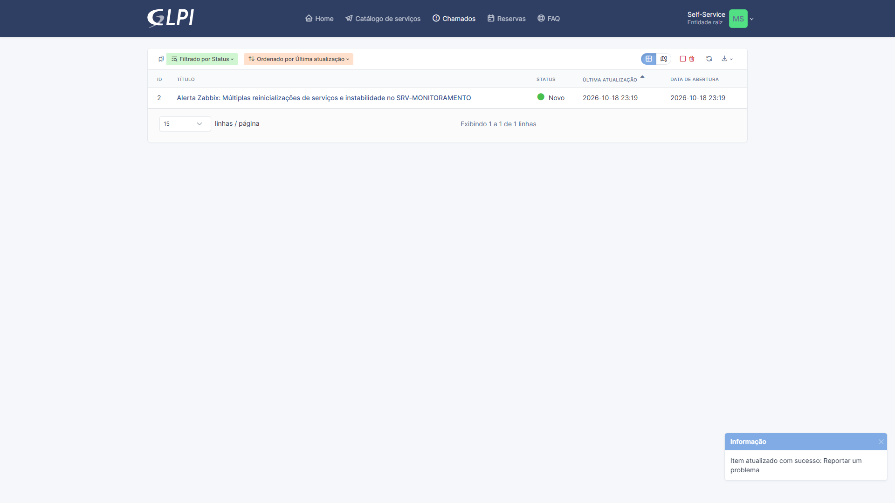

## Etapa 2 — Primeira investigação: o que o kernel registrou

O kernel em execução era o `7.0.0-38-generic` (`uname -r`). Consulta ao journal do boot atual:

```bash
sudo journalctl -k -b --no-pager | grep -Ei 'soft lockup|hard lockup|rcu.*stall|timer handling issue|clocksource: Long readout interval|watchdog'
```

Resultado:

- `watchdog: BUG: soft lockup - CPU#3 stuck for 39s! [swapper/3:0]` em **18/10 23:07:27 UTC** (20:07 BRT), cerca de 2 min 16 s depois do boot;
- `clocksource: Long readout interval` de ~39 s no mesmo instante;
- nenhuma ocorrência de *hard lockup*, *RCU stall* ou *timer handling issue* nessa consulta.

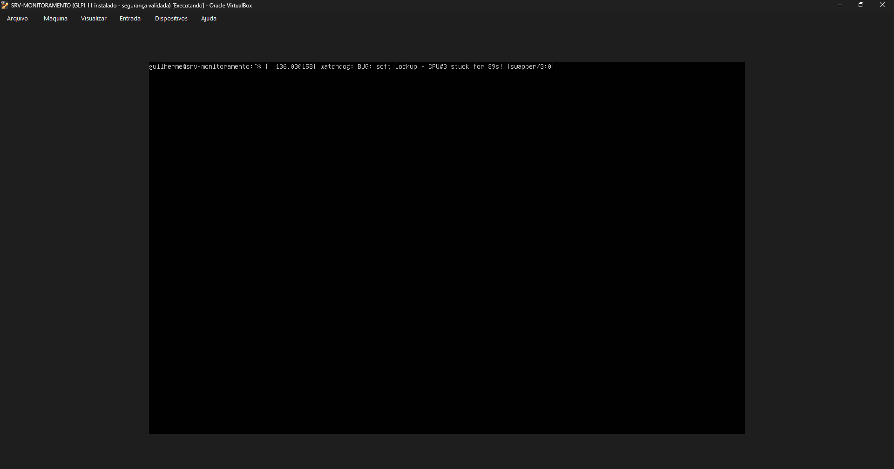
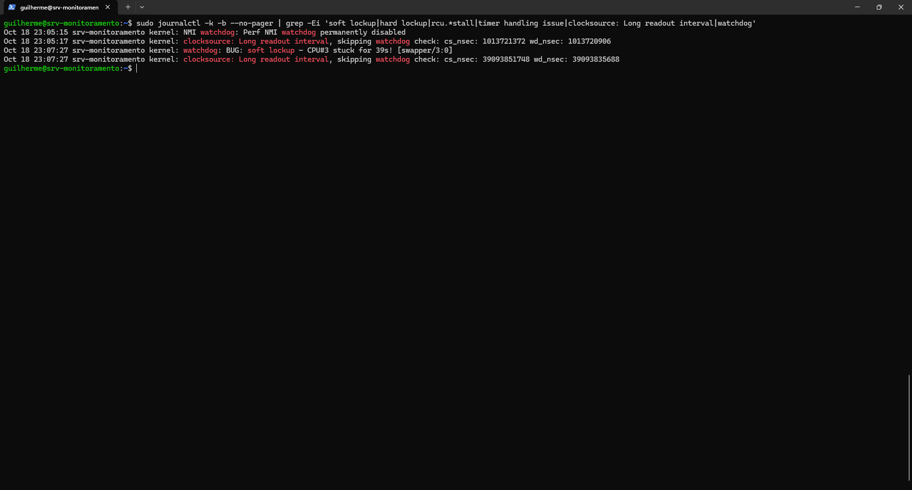

O contexto de 23:06 a 23:10 mostrou o rastreamento terminando em `pv_native_safe_halt`, no caminho de inatividade da CPU. No mesmo trecho apareceram negações do AppArmor para o perfil `who` (leitura de `/etc/passwd` e `/etc/nsswitch.conf`); não há relação demonstrada entre elas e as paradas, e o AppArmor não foi alterado.

## Etapa 3 — Registro e atribuição no GLPI

Com a conta `admin.pessoal`, no chamado #2:

1. **Atores → Atribuído:** selecionado **TI Técnico** (`tecnico.ti`).
2. **Responder:** acompanhamento *"Investigação técnica — 18/10/2026"* com o soft lockup, o kernel em execução, o intervalo longo do *clocksource* e o diagnóstico *"causa raiz ainda não identificada"*.

Depois do acompanhamento o GLPI passou o status para **Em atendimento (atribuído)**. O chamado não recebeu solução.

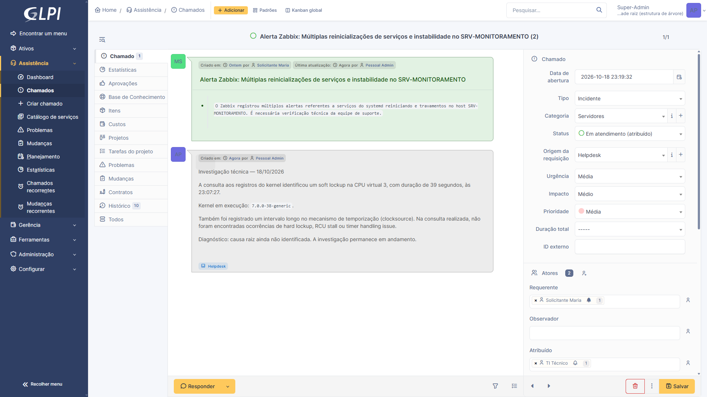

## Etapa 4 — Correlação com o Grafana

O dashboard `Homelab - Monitoramento de Infraestrutura` foi aberto no intervalo **18/10 20:00 a 20:15 BRT** (o soft lockup foi às 20:07 BRT):

- CPU entre cerca de 1% e 9%, sem pico, queda abrupta ou lacuna;
- disco estável em ~20%;
- uptime compatível com o boot das 20:05 BRT;
- *Active Problems*: 0.

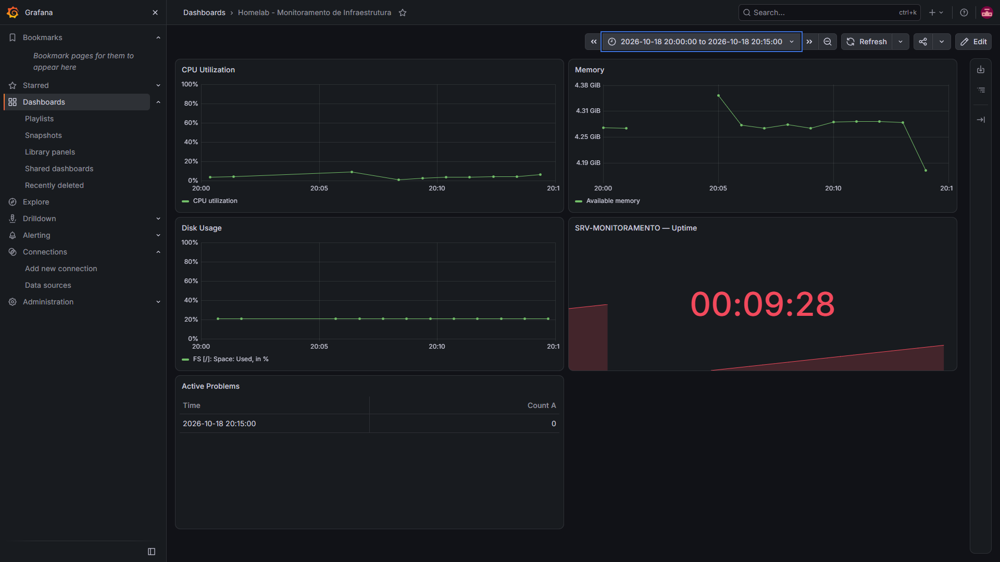

Ressalva registrada no chamado: a coleta do Zabbix é espaçada, então um lockup de 39 s pode ter ocorrido entre duas coletas. A ausência de pico no gráfico **não descarta** o evento.

Para comparar os horários foi conferido o fuso do servidor:

```bash
timedatectl
```

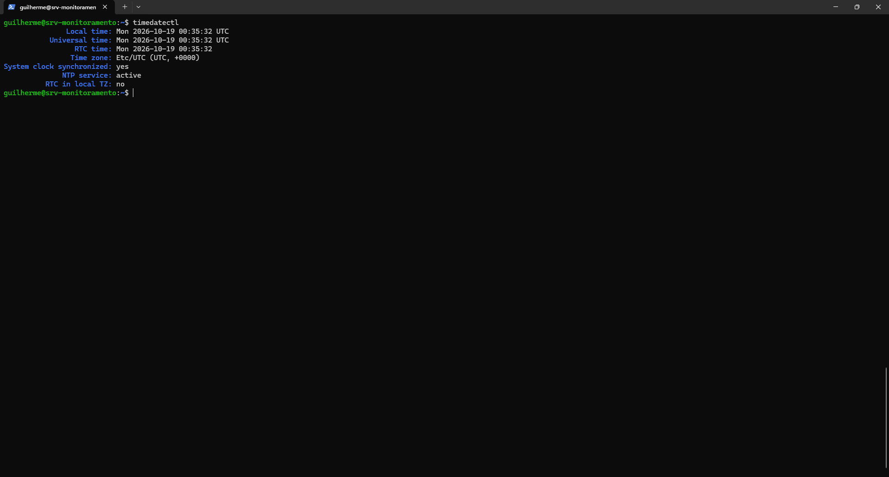

## Etapa 5 — Linha do tempo dos boots

```bash
journalctl --list-boots | tail -n 5
```

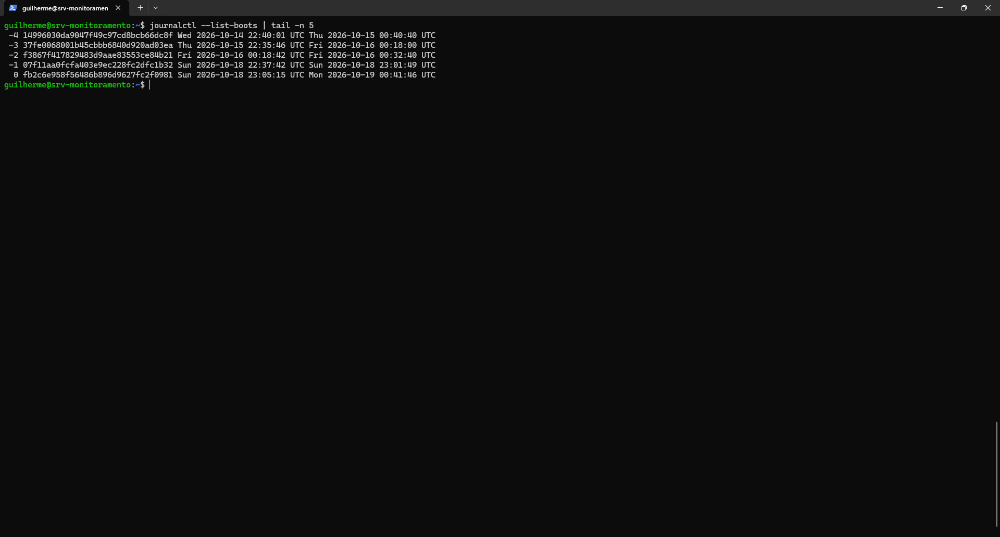

O boot anterior (`22:37:42` a `23:01:49` UTC) terminou de forma limpa. O primeiro acompanhamento dizia que o responsável pelo desligamento não fora identificado; uma segunda consulta ao journal do boot anterior corrigiu isso:

```bash
journalctl -b -2 --since "2026-10-18 23:00:00" --until "2026-10-18 23:01:50" --no-pager | grep -iE "power key|powering down|sudo|COMMAND|shutdown|poweroff"
```

O registro mostra `sudo ... COMMAND=/usr/sbin/shutdown -h now`, executado pelo usuário `guilherme` em `pts/0`, com Grafana e MariaDB finalizados normalmente. Ou seja, foi um desligamento voluntário, **não** uma falha. O acompanhamento foi corrigido no GLPI.

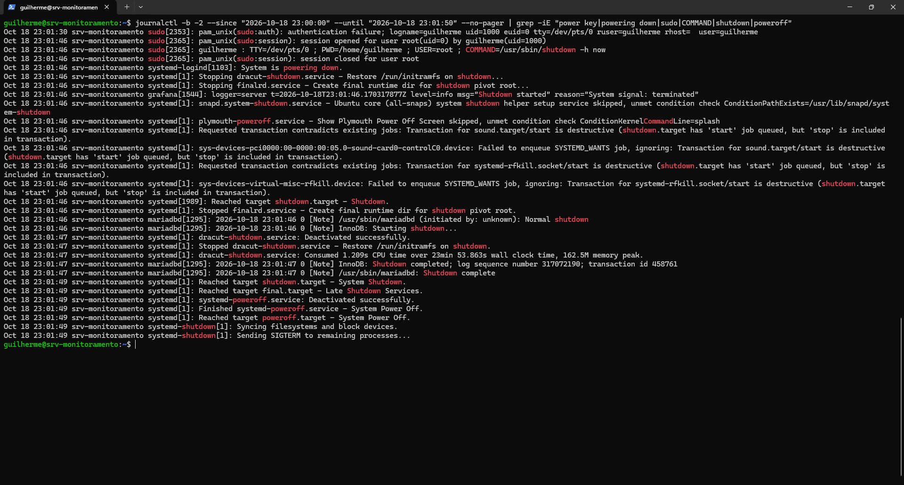
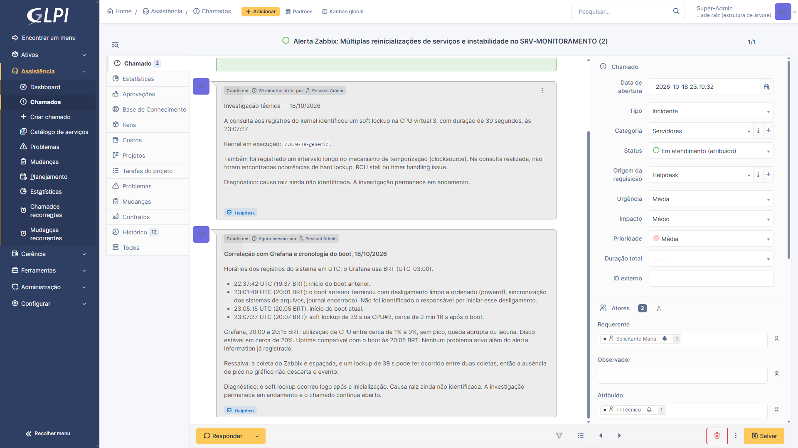

## Etapa 6 — Novos eventos e evidências do host (19/10)

O acompanhamento de 19/10 registrou, no boot iniciado em 18/10 às 23:05:15 UTC, três soft lockups, todos na CPU#3:

| UTC | BRT | Duração | Processo |
| :--- | :--- | :-: | :--- |
| 18/10 23:07:27 | 20:07 | 39 s | `swapper/3:0` |
| 19/10 00:30:05 | 21:30 | 65 s | `zabbix_agent2` |
| 19/10 00:48:24 | 21:48 | 30 s | `zabbix_agent2` |

No Zabbix/Grafana, o item `System uptime` teve uma lacuna de cerca de 1 min 30 s por volta das 21:29–21:30 BRT, coincidindo com o evento das 21:30. O uptime não caiu, então não houve reinicialização. A consulta foi feita no Explore do Grafana, item `System uptime`, de 21:25 a 21:55 BRT:

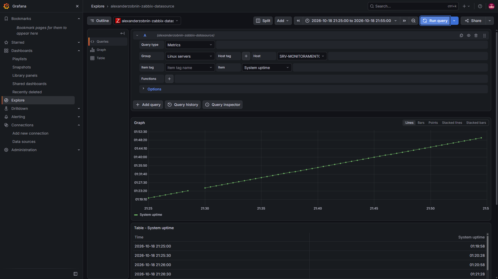

Esse boot terminou por **desligamento forçado** pelo VirtualBox ("Desligar a máquina"), por volta de 01:15 UTC (22:15 BRT de 18/10), horário calculado a partir do `VBox.log`.

No boot seguinte (19/10, 22:38 UTC) os eventos voltaram:

```bash
journalctl -k --since "2026-10-19 23:26:00" --no-pager | grep -iE "soft lockup|rcu.*stall|timer handling|Long readout"
```

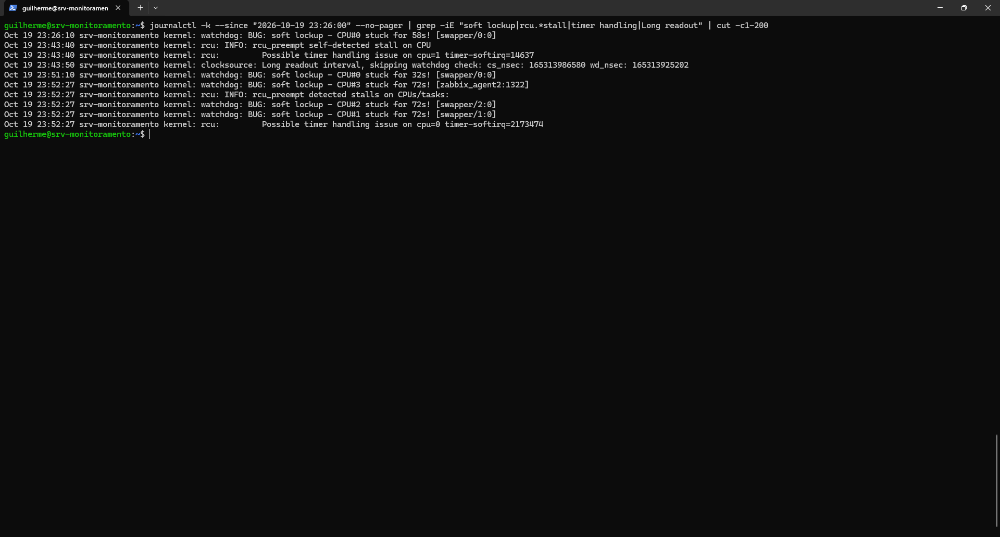
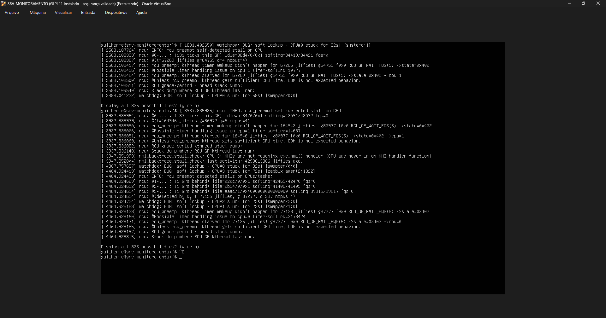

Registrados às 23:08 (32 s) e 23:21 (RCU stall) em uma consulta anterior ao journal, sem captura, e, na consulta da imagem acima (a partir de 23:26), às 23:26 (58 s), 23:43 (RCU stall, relógio parado por 165 s), 23:51 (32 s) e 23:52 UTC (72 s em três vCPUs ao mesmo tempo). O log do VirtualBox registrou que o convidado ficou sem responder **nos mesmos horários**, com durações compatíveis, e o relógio do Ubuntu não ficou defasado.

Guest Additions: o log do VirtualBox mostrava versão **6.0.0** contra o host 7.2.16. Conferindo dentro da VM:

```bash
modinfo vboxguest | grep -iE "^filename|^version"
```

O módulo `vboxguest` fica em `/lib/modules/7.0.0-38-generic/kernel/drivers/virt/vboxguest/`, ou seja, é o driver que já vem **dentro do kernel do Ubuntu**, e não uma instalação separada. A diferença de versão é característica desse driver embutido e **não** indica Guest Additions desatualizados; essa pista foi descartada.

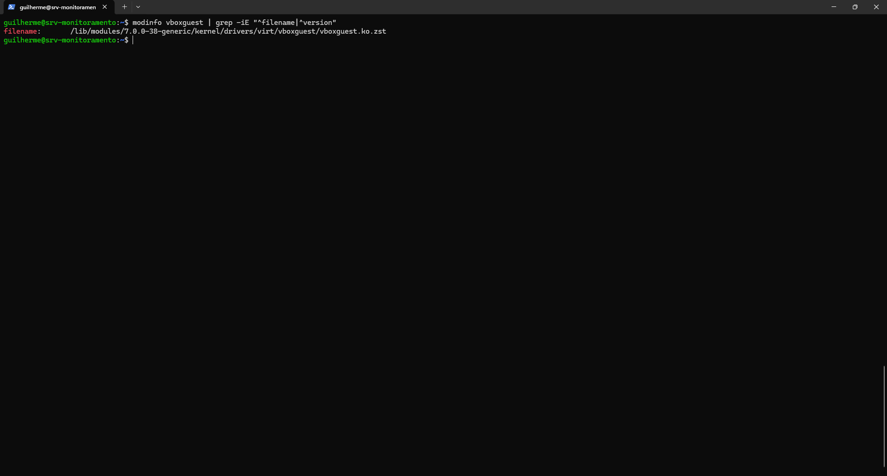

No host: Windows 11 com VirtualBox 7.2.16 em modo **NEM** (sobre o hipervisor do Windows, com Integridade de Memória ativada), 4 vCPUs. Em duas medições feitas logo depois de paradas, o Windows tinha CPU e memória livres. O plano de energia do Windows estava em **Alto desempenho**.

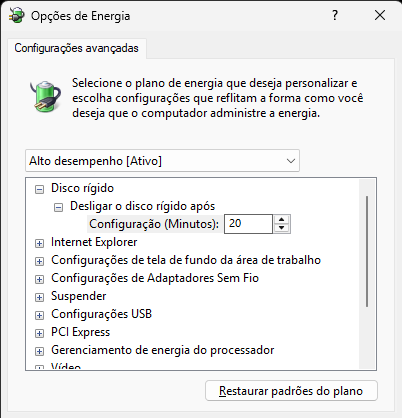
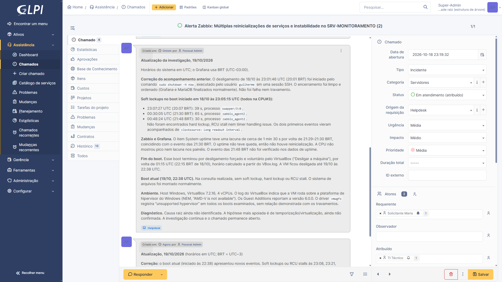

## Etapa 7 — Problema #1 no GLPI

Como o mesmo sintoma se repetiu em boots diferentes, foi criado o **Problema #1**, *Instabilidade da VM SRV-MONITORAMENTO por paradas de execução (soft lockups)*, com sintomas (paradas de 30 s a cerca de 165 s, em várias vCPUs), evidências, ambiente e a causa provável **não confirmada**: execução da VM sobre o hipervisor do Windows. O chamado #2 foi vinculado ao problema.

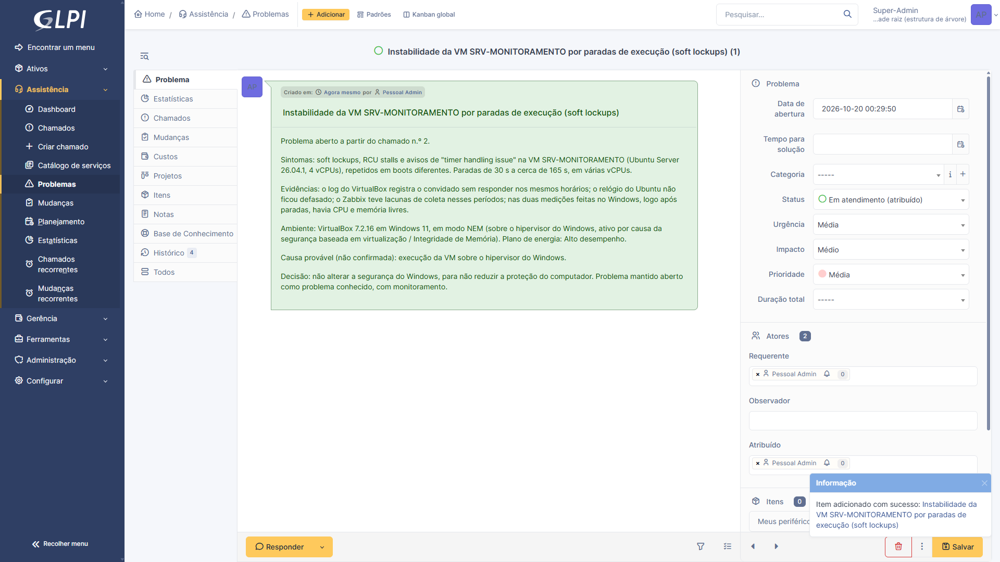
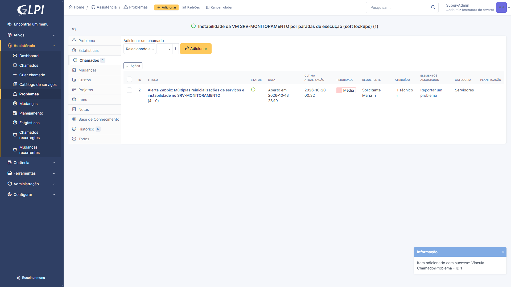

## Etapa 8 — Decisão e encerramento da investigação

A causa provável é a execução da VM sobre o hipervisor do Windows (VirtualBox em modo NEM, ativo por causa da segurança baseada em virtualização / Integridade de Memória). A decisão já constava no texto do Problema #1 quando ele foi criado, em 19/10. Reduzir essa proteção do computador para tentar corrigir o homelab foi considerado uma troca ruim, então:

> **Decisão:** não alterar a segurança do Windows. Problema mantido aberto como problema conhecido, com monitoramento.

Em 21/10 foi acrescentada uma nota ao Problema #1 e ao chamado #2, confirmando o encerramento da investigação e registrando uma nova ocorrência (21/10 23:26:34 UTC, CPU#3, 56 s). O chamado permanece **aberto**, vinculado ao Problema #1, monitorado pelo Zabbix.

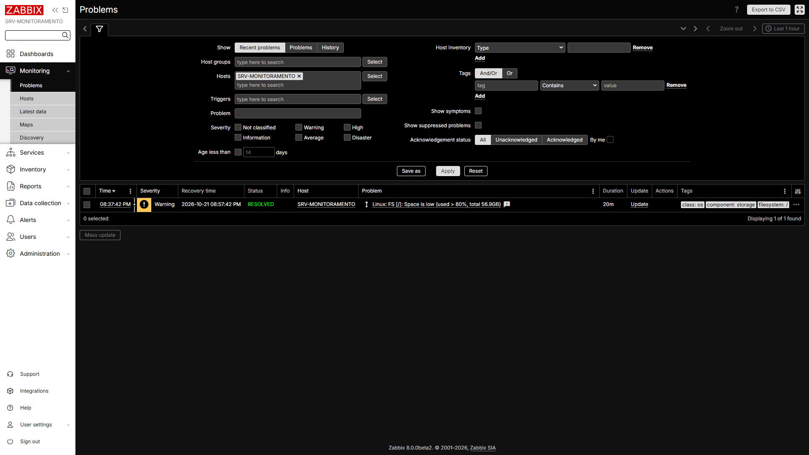
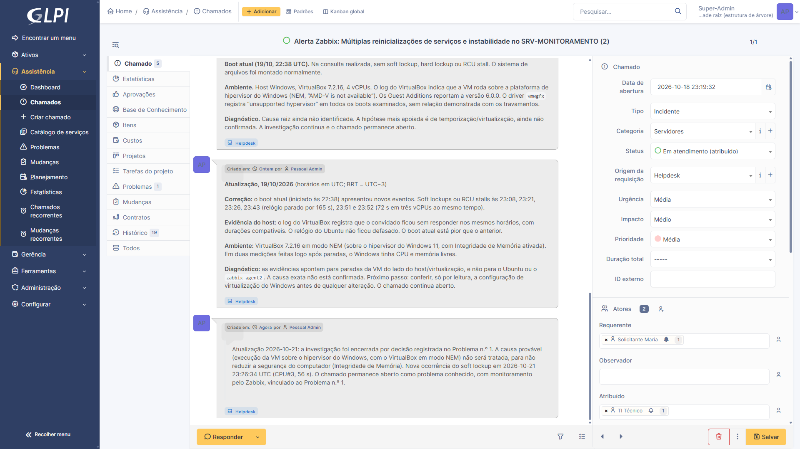

---

## ⚠️ Problemas encontrados e como foram tratados

| # | Problema | Causa | Tratamento |
| :-: | :--- | :--- | :--- |
| 1 | *Soft lockups*, RCU stalls e avisos de `timer handling issue` na VM, de 30 s a ~165 s, em várias vCPUs e em boots diferentes | O log do VirtualBox registra o convidado sem responder nos mesmos horários; causa provável: VM executando sobre o hipervisor do Windows (modo NEM). **Não confirmada** | Não corrigido. Decisão de manter a segurança do Windows; Problema #1 aberto como problema conhecido, com monitoramento |
| 2 | Lacunas de coleta no Zabbix/Grafana (por exemplo no `System uptime`, ~1 min 30 s às 21:29–21:30 BRT de 18/10) | A VM parada não coleta nem envia dados | Registrado no chamado como ressalva: a ausência de pico no gráfico não descarta um evento |

---

## ✅ Checklist da Fase 6

- [x] Estado do host e alertas conferidos no Zabbix
- [x] Chamado #2 aberto, categorizado e atribuído ao técnico
- [x] Investigação com journal, `timedatectl`, `list-boots` e log do VirtualBox
- [x] Correlação com o dashboard do Grafana
- [x] Acompanhamentos técnicos registrados e corrigidos no GLPI
- [x] Problema #1 criado e vinculado ao chamado
- [x] Decisão registrada (manter a segurança do Windows)
- [ ] Causa raiz confirmada (permanece como causa provável)
- [ ] Chamado #2 resolvido (mantido aberto como problema conhecido)

## 🎓 O que esta fase demonstra

- Ciclo de incidente: detecção, investigação com evidências, registro, escalonamento para problema e decisão documentada.
- Correlação entre ferramentas e fusos horários diferentes (UTC no servidor e no GLPI, BRT no Grafana e no Zabbix).
- Honestidade técnica: o que foi confirmado, o que é apenas provável e uma correção do próprio registro quando uma evidência nova contradisse o primeiro acompanhamento.

**Próxima fase:** Fase 7 — simulação profissional: incidentes provocados de propósito (CPU alta, serviço parado, disco e conectividade), com alerta no Zabbix, evidência no Grafana e chamado no GLPI.
