# Fase 7 — Simulação profissional: incidentes provocados e o ciclo completo

> **Objetivo:** provocar de propósito quatro incidentes no `SRV-MONITORAMENTO` (CPU alta, serviço parado, disco cheio e perda de conectividade externa) e verificar, para cada um, se o ciclo funciona: o **Zabbix** alerta, o **Grafana** mostra o evento, o **GLPI** registra o chamado e a recuperação é confirmada.

| Item | Valor |
| :--- | :--- |
| Ferramentas | Zabbix 8.0.0beta2, Grafana 13.2.3, GLPI 11.0.11 |
| Host monitorado | `SRV-MONITORAMENTO` (`192.168.100.86`) |
| Cenários | CPU alta (inconclusivo), serviço `cron` parado, disco cheio, sem conectividade externa |
| Registro no GLPI | Chamados **#3**, **#4** e **#5** (o cenário de CPU não gerou chamado) |
| Período | 20/10 e 21/10/2026 |

> **Fuso horário:** o journal do Ubuntu e o GLPI usam **UTC**; o Grafana e a interface do Zabbix mostram **BRT (UTC−3)**. Nos textos abaixo, os dois aparecem quando é importante.

> **Todos os incidentes são simulados.** Cada um foi causado por mim, por comando, e desfeito por comando. Nenhum chamado descreve falha real do serviço.

## Fluxo de cada cenário

```text
   Provocar o incidente (comando)
      │
      ▼
   Zabbix: trigger dispara (Problems)
      │
      ▼
   Investigação no terminal  ──►  GLPI: chamado (análise, causa, solução)
      │
      ▼
   Correção (comando)  ──►  Zabbix: RESOLVED  ──►  chamado fechado
      │
      ▼
   Grafana: evento visível no dashboard
```

O registro no GLPI foi feito **à mão**, como na Fase 6: o chamado foi aberto pela solicitante (Maria) e a análise, a causa e a solução foram escritas pelo técnico. Não há integração automática entre Zabbix e GLPI.

---

## Linha do tempo

| Data | Evento |
| :--- | :--- |
| 20/10 | Triggers de CPU conferidos; baseline; teste de carga de CPU (4 min) — **inconclusivo** |
| 21/10 19:59 | Cenário 2: `cron` parado → alerta → chamado #3 → recuperação 20:15 |
| 21/10 20:33 | Cenário 3: disco a 86% → alerta 20:37 → chamado #4 → recuperação 20:57 |
| 21/10 21:19 | Criado o item e o trigger de conectividade externa |
| 21/10 21:26 | Cenário 4: bloqueio de `8.8.8.8:53` → alerta 21:28 → chamado #5 → recuperação 21:43 |
| 21/10 22:04 | Dashboard do Grafana ampliado para 7 painéis |

---

## Cenário 1 — CPU alta (resultado: inconclusivo)

### Triggers de CPU existentes

Antes do teste, os triggers de CPU foram conferidos em **Data collection → Hosts → Triggers**. Dois estavam ativos e sem problema:

| Trigger | Severidade | Expressão |
| :--- | :--- | :--- |
| `Linux: High CPU utilization` (template) | Warning | `min(...system.cpu.util,5m)>{$CPU.UTIL.CRIT}`, com `{$CPU.UTIL.CRIT}` = 90 e dependência do *Load average* |
| `Uso elevado de CPU (> 70%)` (criado por mim) | Average | `avg(/SRV-MONITORAMENTO/system.cpu.util,1m)>70` |

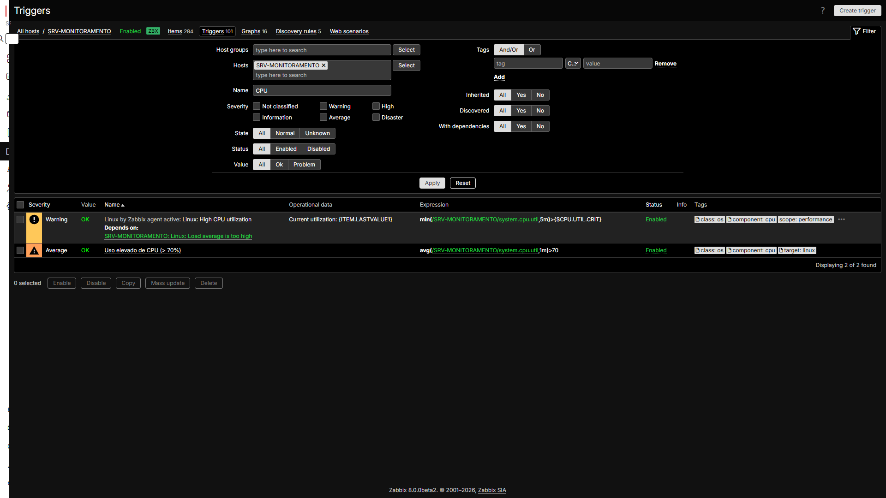
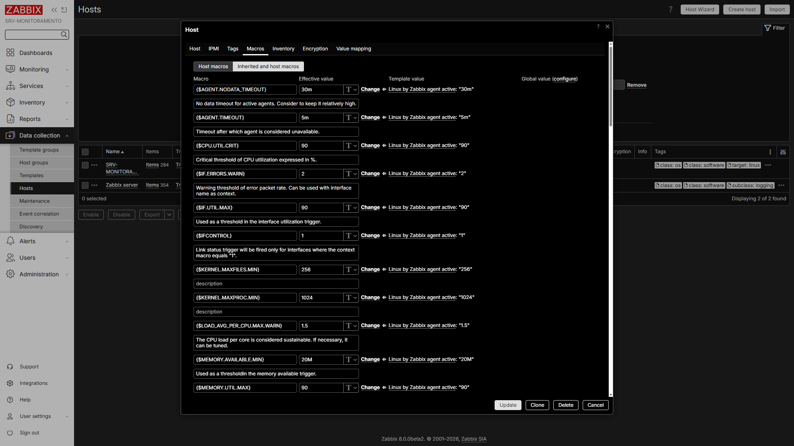

### Baseline

Em 20/10 o host estava ocioso (*load average* 0,07) e o Zabbix mostrava **"No data found"** em Problems às 20:17. Mesmo assim, o journal registrou *soft lockups* durante a preparação (23:17:32, 23:18:02 e 23:29:35 UTC, de 21 a 28 s). Foi verificada a hipótese de que o Grafana fosse a causa: a tabela de requisições por minuto no log de acesso do Apache mostrou rajadas sem travamento e um travamento com apenas 8 requisições por minuto, então a hipótese perdeu força. Fechar todas as abas do Grafana reduziu as requisições a 0 (antes havia 5–9 por minuto de fundo).

A linha de base foi invalidada três vezes por novos travamentos. Ela ficou limpa por cerca de 15 minutos (journal sem eventos de 23:29:36 a 23:44:55 UTC), e o teste começou nessa janela.

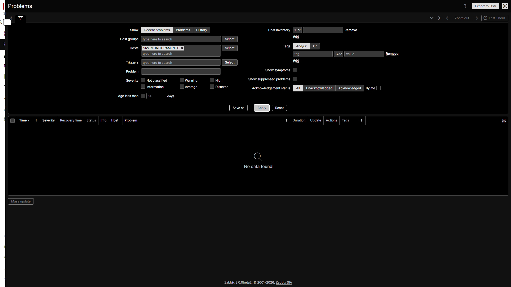
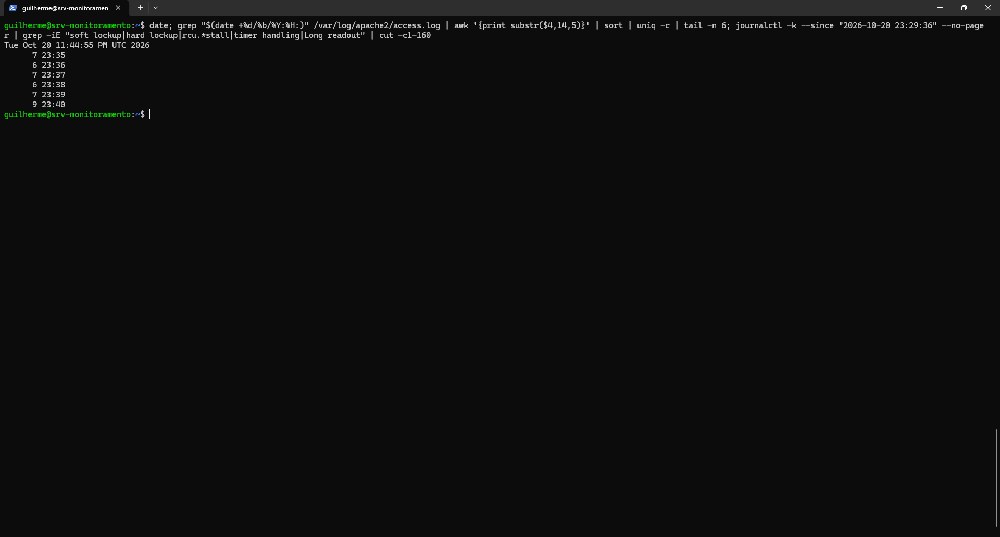

### O teste

```bash
date; timeout 240 sh -c 'for i in 1 2 3 4; do (while :; do :; done) & done; wait'; date
```

Quatro processos em laço, um por vCPU, por 4 minutos. O comando terminou em **5 min 27 s**, não em 4 (23:47:02 → 23:52:29 UTC). Depois do teste, `pgrep` não mostrava nenhum processo remanescente.

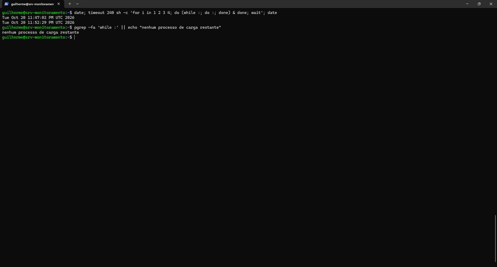

### O que o sistema registrou

No fim do teste o journal mostrou o `systemd-udevd` e o `snapd` estourando o *watchdog*, o `journald` falhando por `watchdog`, o aviso `rcu: Possible timer handling issue on cpu=3` e um `clocksource: Long readout interval` de **327 s**, a maior parada registrada na VM. O `chronyd` registrou *Forward time jump detected*. Mais tarde (21:03 BRT), `systemd-networkd`, `systemd-resolved` e `systemd-networkd-wait-online` também reiniciaram, e o Zabbix alertou. O `systemctl --failed` às 00:03:30 UTC mostrava 0 unidades.

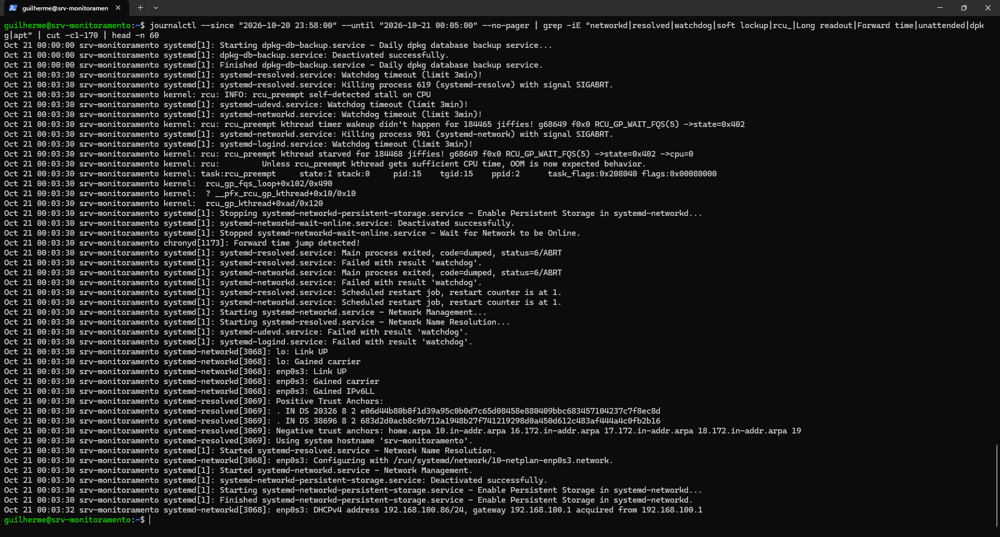
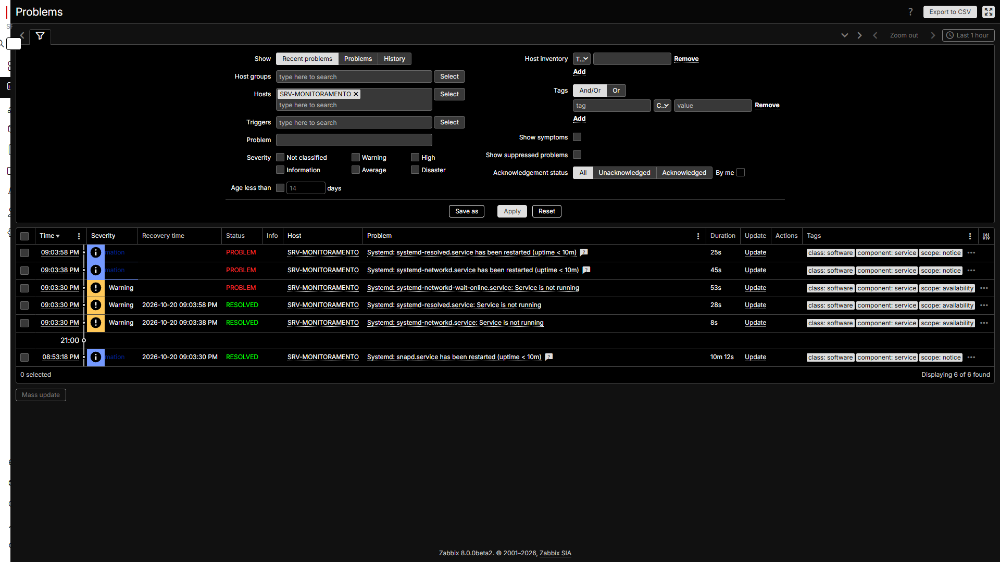

### Resultado

O alerta `Uso elevado de CPU (> 70%)` **não disparou**. Em "Recent problems", às 21:04, havia 6 itens e nenhum era de CPU. Não é possível dizer que o trigger funciona nem que falha, porque a VM ficou parada por minutos durante o teste. Três explicações ficaram em aberto, sem confirmação:

1. o agente não conseguiu enviar os dados a tempo, por causa da parada;
2. os saltos de relógio levaram a média de 1 minuto para abaixo de 70%;
3. a carga não chegou a 70% (a menos provável, com 4 laços em 4 vCPUs).

> **Decisão:** registrar o cenário como **inconclusivo**, sem chamado no GLPI. Repetir com uma carga mais curta (cerca de 90 s) numa janela em que a VM esteja estável fica como melhoria futura.

---

## Cenário 2 — Serviço parado (`cron`) — Chamado #3

**Gatilho no Zabbix:** `Systemd: cron.service: Service is not running` (Warning).

| Passo | Horário (BRT) | Detalhe |
| :--- | :--- | :--- |
| `systemctl stop cron` | 19:58:10 | O journal mostra SIGTERM e *Deactivated successfully* |
| Alerta no Zabbix | 19:59:03 | `cron.service: Service is not running` |
| Chamado #3 aberto | 20:04 | Solicitante Maria; técnico `TI Técnico` |
| `systemctl start cron` | 20:14:56 | `is-active` retornou `active` |
| Zabbix RESOLVED | 20:15:03 | Duração: 16 min; também apareceu "cron.service has been restarted (uptime < 10m)" |
| Chamado #3 fechado | 20:20 | Solução registrada |

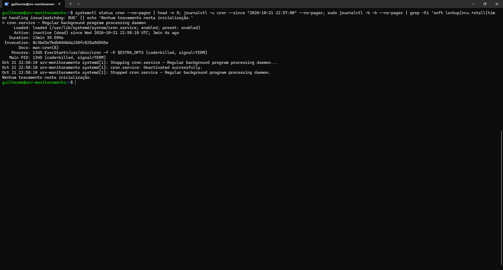

**Análise registrada no chamado:** parada manual do serviço, sem relação com o Problema #1; ação: reiniciar e confirmar a recuperação no Zabbix.

```bash
date -u; sudo systemctl start cron; systemctl is-active cron; date -u
```

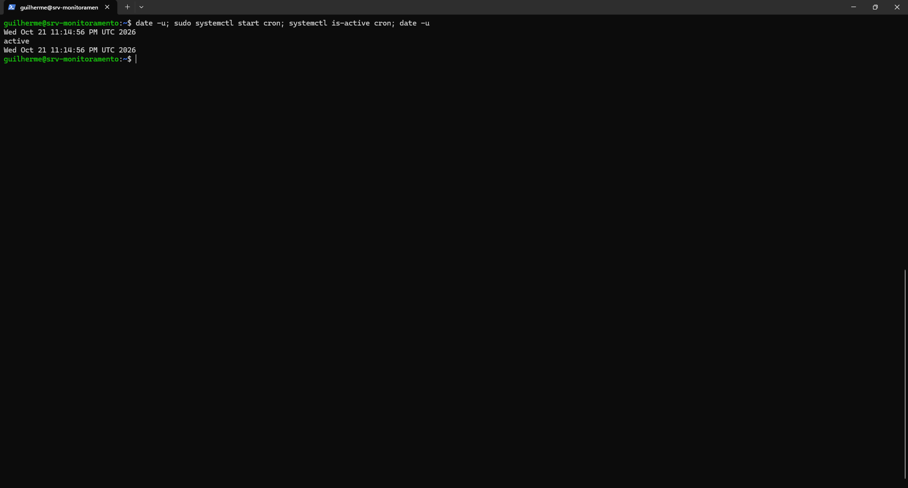
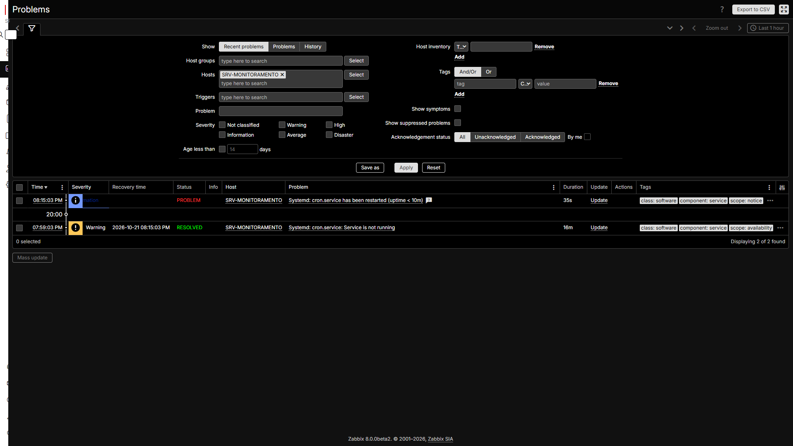
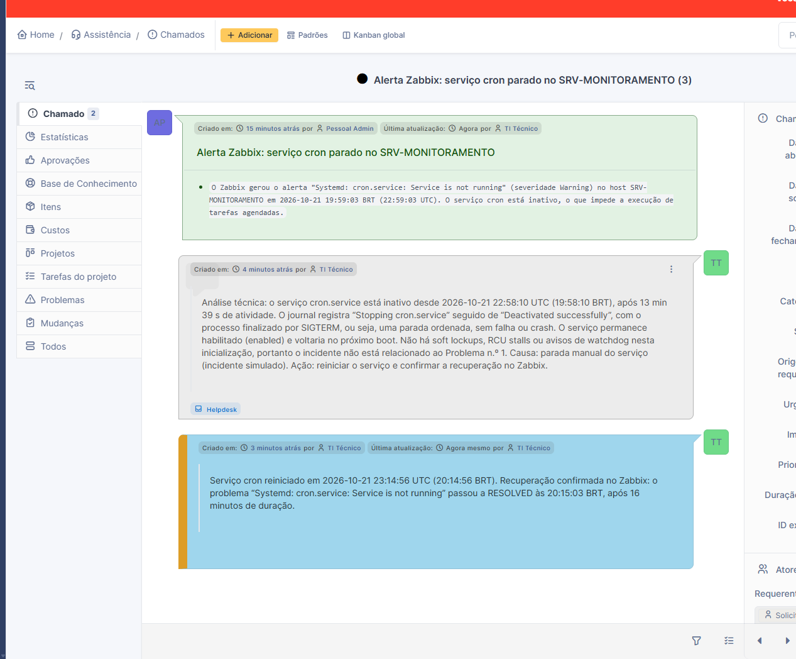

---

## Cenário 3 — Disco cheio — Chamado #4

**Gatilho no Zabbix:** `Linux: FS [/]: Space is low (used > 80%, total 56.9GB)` (Warning).

Estado inicial (`df -h / /boot`): `/` com **22%** (12 G usados, 43 G livres) e `/boot` com 10%. Os triggers de espaço do template e as macros de limite do host foram conferidos antes do teste.

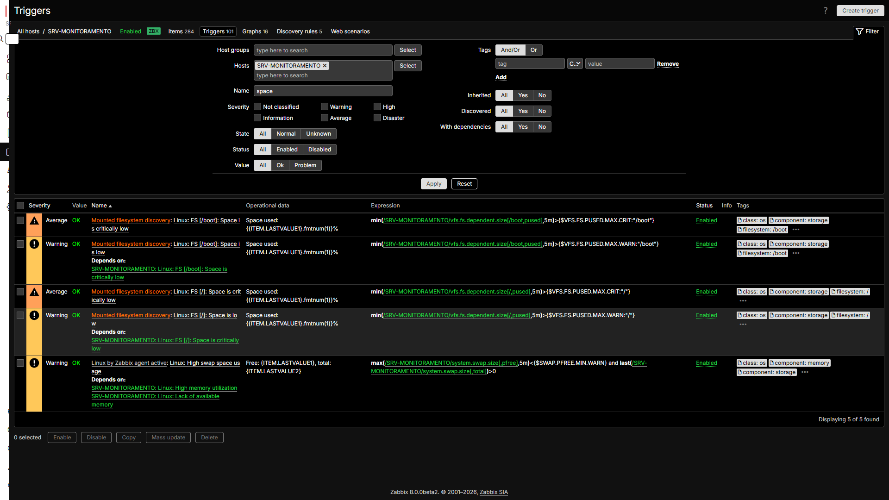

### Provocar

```bash
date -u; sudo fallocate -l 35G /var/tmp/teste-disco-cheio.bin; df -h /; date -u
```

Resultado: `/` em **86%** (47 G usados, 7,8 G livres), às 23:33:26–23:33:32 UTC (20:33 BRT).

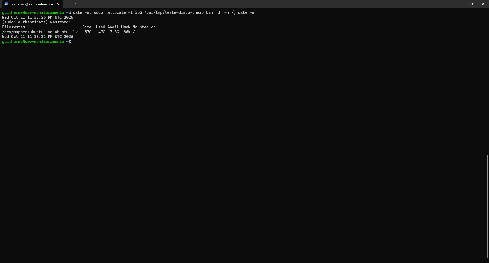

### Alerta e investigação

O Zabbix alertou às **20:37:42** BRT. No terminal, `du` apontou o caminho do consumo: `/var` (38 G) → `/var/tmp` (36 G) → `teste-disco-cheio.bin` (35 G, criado às 23:33 UTC).

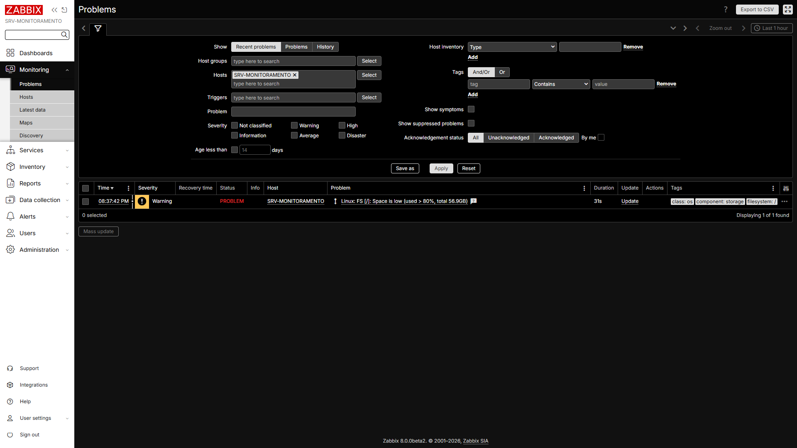
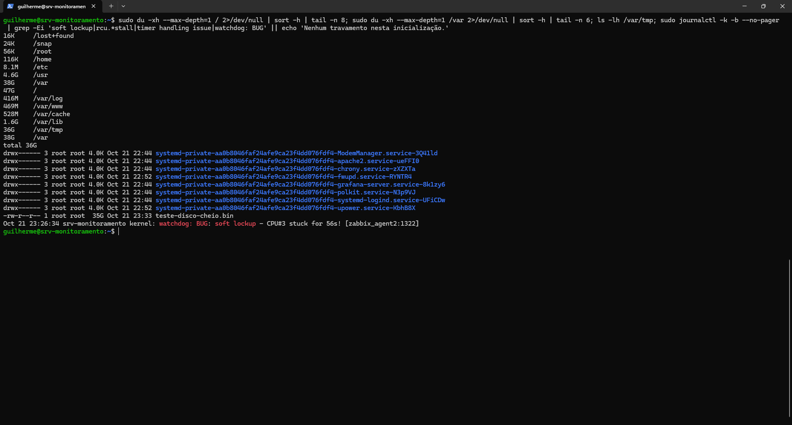

### Chamado #4

Aberto às 20:52 BRT. A análise registrada: maior consumidor em `/var`, depois `/var/tmp`, até o arquivo; causa: arquivo temporário criado manualmente (simulado). Um *soft lockup* às 23:26:34 UTC (CPU#3, 56 s) foi anotado como **sem relação** com o disco e ligado ao Problema #1.

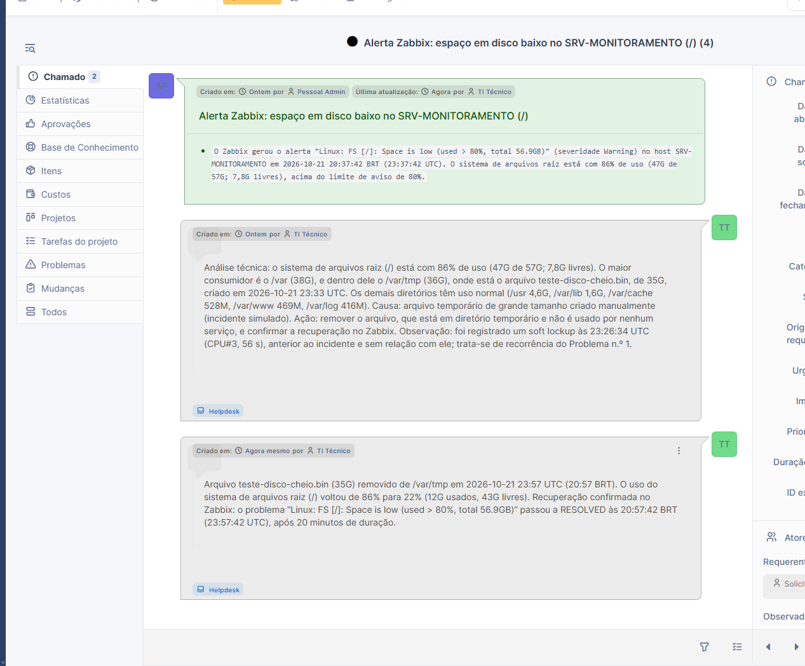

### Correção e recuperação

```bash
date -u; sudo rm -v /var/tmp/teste-disco-cheio.bin; df -h /; date -u
```

Às 23:57:34–23:57:38 UTC, `/` voltou a **22%** (12 G usados, 43 G livres). O Zabbix marcou **RESOLVED às 20:57:42** (duração: 20 min) e o chamado #4 foi fechado (última atualização às 21:07).

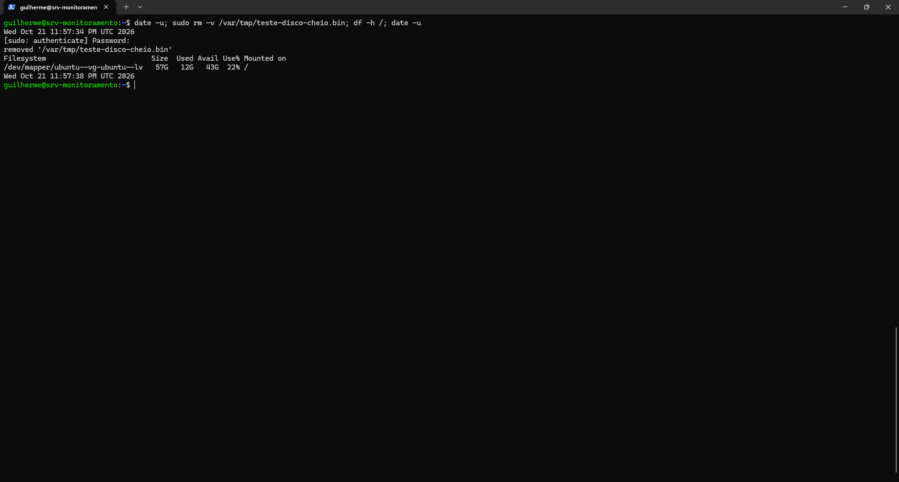
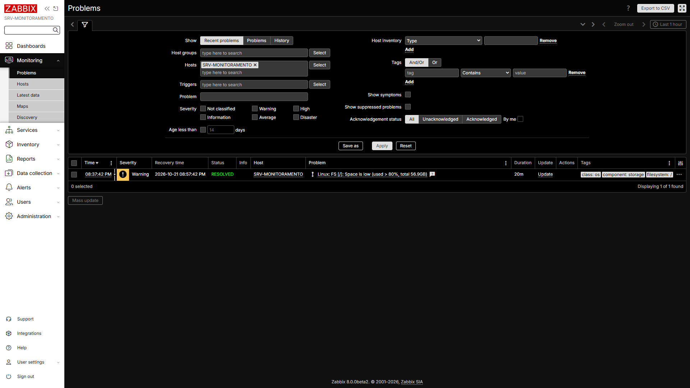

---

## Cenário 4 — Sem conectividade externa — Chamado #5

Esse cenário não tinha monitoramento prévio. Foi criado antes do teste:

| Objeto | Valor |
| :--- | :--- |
| Item | `Conectividade externa: DNS 8.8.8.8 (TCP 53)` — chave `net.tcp.service[tcp,8.8.8.8,53]`, tag `scope: availability` |
| Trigger | `Sem conectividade externa (DNS 8.8.8.8:53 inacessível)` (Warning) |

O item foi criado entre 21:19 e 21:20 BRT; em **Latest data** o último valor era `1` (porta acessível).

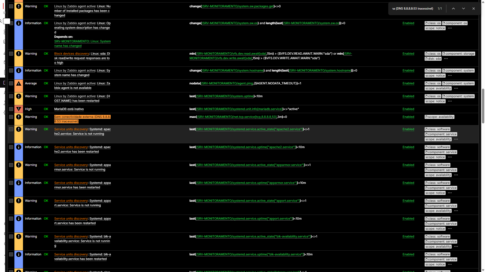

### Provocar

Antes do bloqueio, `nft list ruleset`, `which iptables ufw` e `systemctl is-active ufw` mostraram que o `iptables` e o `ufw` estavam presentes e o `ufw` ativo. A regra foi inserida na cadeia `OUTPUT` do `iptables`:

```bash
sudo iptables -I OUTPUT -d 8.8.8.8 -p tcp --dport 53 -j REJECT --reject-with tcp-reset
```

Às 00:26:01 UTC de 22/10 (21:26 BRT) a regra estava ativa e a conexão com `8.8.8.8:53` foi recusada. O mesmo comando também limpou restos de uma tentativa anterior com `ufw` e um *timer* de remoção automática (`remove-block-iptables`), que foi cancelado: a remoção foi feita à mão, depois da investigação.

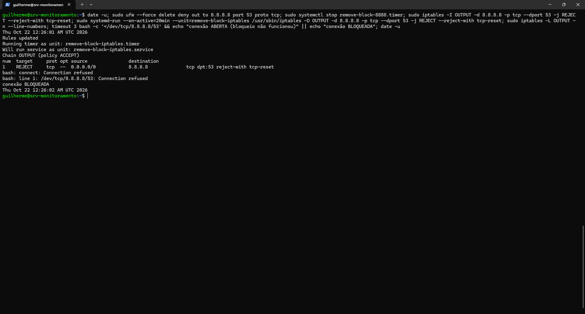

### Alerta e investigação

O Zabbix alertou às **21:28:28** BRT. A investigação no terminal separou a causa:

| Verificação | Resultado |
| :--- | :--- |
| Interface `enp0s3` | UP, `192.168.100.86/24` |
| Rota padrão | via `192.168.100.1` |
| `ping 8.8.8.8` | 0% de perda (média de 19 ms) |
| `1.1.1.1:53` | aberta |
| `8.8.8.8:53` | **recusada** |
| `iptables -L OUTPUT` | regra `REJECT` para `8.8.8.8` porta 53 |

A rede, a rota e o ICMP funcionavam; só a porta TCP 53 daquele destino estava barrada. O journal do kernel mostrou ainda um *soft lockup* às 00:22:05 UTC (CPU#3, 21 s), anotado como sem relação com a conectividade.

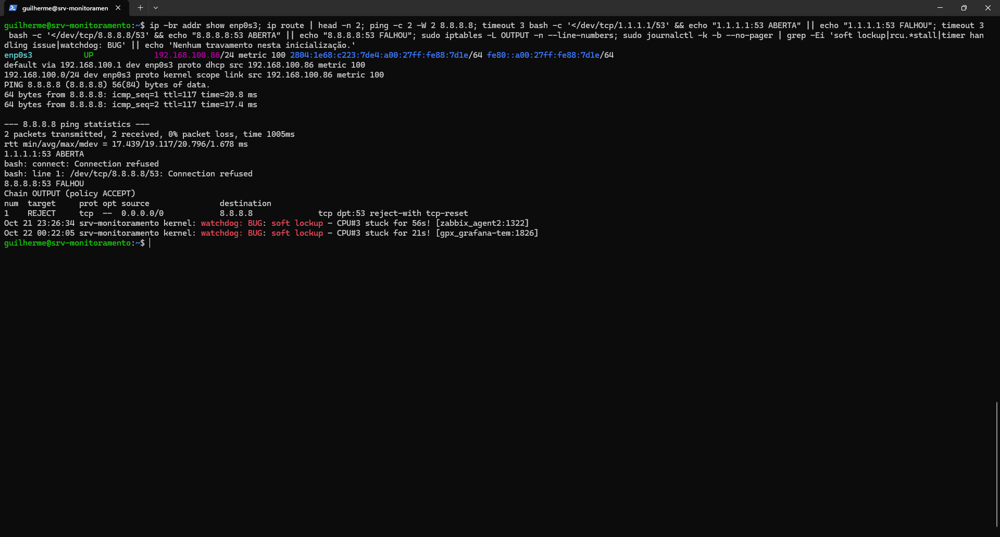

### Chamado #5

Aberto às 21:39 BRT, com a análise técnica, a causa (regra `REJECT` na cadeia `OUTPUT`, incidente simulado) e a solução. Fechado às 21:48.

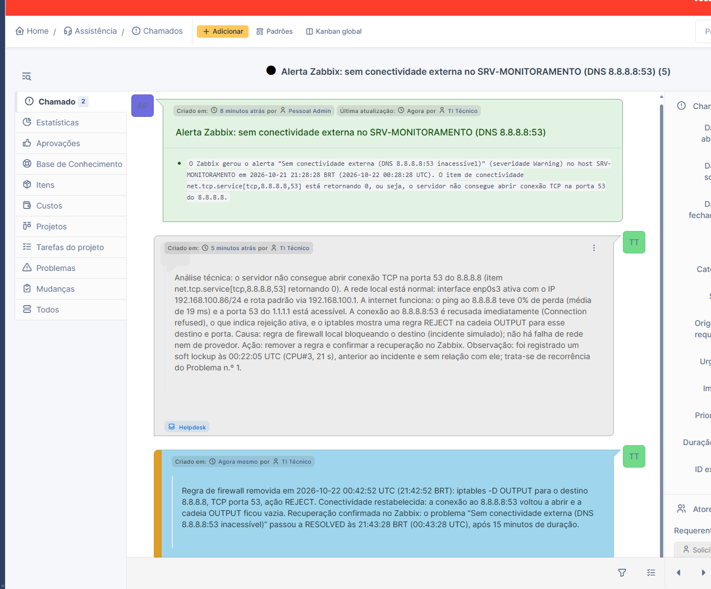

### Correção e recuperação

```bash
date -u; sudo iptables -D OUTPUT -d 8.8.8.8 -p tcp --dport 53 -j REJECT --reject-with tcp-reset
```

Às 00:42:52 UTC (21:42:52 BRT) a porta voltou a responder ("8.8.8.8:53 ABERTA"). O Zabbix marcou **RESOLVED às 21:43:28** (duração: 15 min).

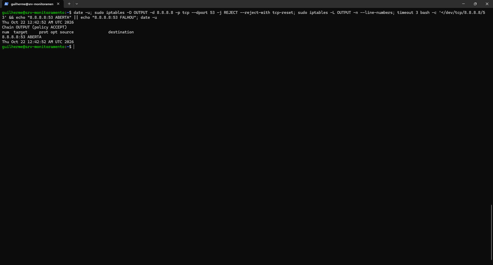
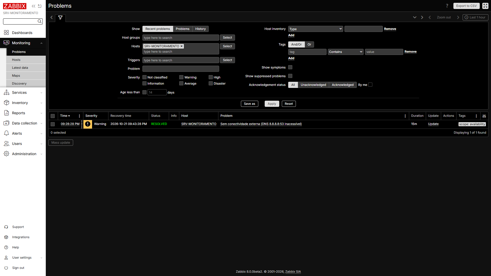

---

## Grafana — os eventos no dashboard

O dashboard **Homelab - Monitoramento de Infraestrutura** foi ampliado para **7 painéis**: CPU Utilization, Memory, Disk Usage, Uptime, **Cron Service State**, **External Connectivity** e Active Problems.

| Painel novo | Item do Zabbix | Configuração |
| :--- | :--- | :--- |
| Cron Service State | `cron.service: Active state` | Unidade *Number*, interpolação *Step after*, mínimo 0 e máximo 4, mapeamento 1 → Ativo e 3 → Inativo |
| External Connectivity | `Conectividade externa: DNS 8.8.8.8 (TCP 53)` | Mínimo 0 e máximo 1, mapeamento 1 → Online e 0 → Bloqueado |

No período de 21/10 19:45 a 21:55, o dashboard mostra:

- **Cron Service State:** *Inativo* de cerca de 19:59 a 20:15.
- **Disk Usage:** cerca de 21% na base e cerca de 86% de ~20:34 a ~20:57.
- **External Connectivity:** *Bloqueado* de cerca de 21:26 a 21:42 (os dados começam em ~21:17, quando o item foi criado).
- **CPU Utilization:** baixa, com um pico pequeno (~13%) por volta de 20:41.
- **Active Problems:** 0 às 21:55.
- **Memory:** quedas perto de 20:00, 20:40 e 21:54, sem investigação nesta fase.
- **Uptime:** o sparkline mostra uma pequena lacuna perto de 20:26, compatível com paradas da VM, mas **não verificada**.

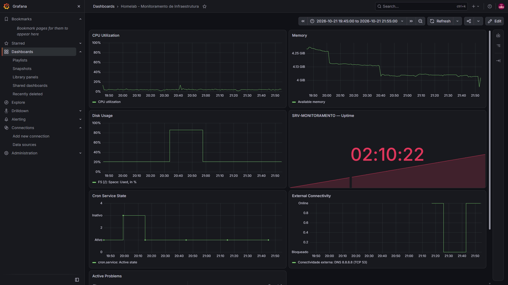

Recortes do mesmo dashboard, no período de 21/10 19:45 a 21:55, mostrando de perto os painéis de CPU, memória, disco e uptime, e o painel de problemas ativos:


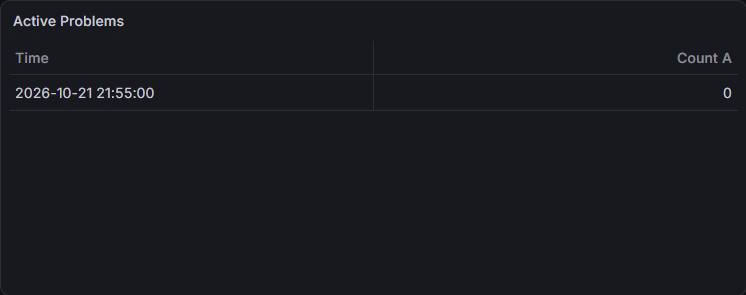

---

## Fechamento no GLPI

Ao fim da fase, a lista de chamados tinha 5 itens: **#1, #3, #4 e #5 fechados** e **#2 em atendimento** (atribuído), vinculado ao Problema #1 como problema conhecido (Fase 6). Em 21/10 foram acrescentadas notas ao chamado #2 e ao Problema #1 com a nova ocorrência do *soft lockup* (23:26:34 UTC, CPU#3, 56 s), sem mudança de causa provável nem de decisão.

| Chamado | Cenário | Aberto (BRT) | Fechado (BRT) |
| :-: | :--- | :-: | :-: |
| #3 | `cron` parado | 20:04 | 20:20 |
| #4 | Disco a 86% | 20:52 | 21:07 |
| #5 | Sem conectividade externa | 21:39 | 21:48 |

---

## ⚠️ Problemas encontrados e como foram tratados

| # | Problema | Causa | Tratamento |
| :-: | :--- | :--- | :--- |
| 1 | O alerta `Uso elevado de CPU (> 70%)` não disparou durante o teste de carga | A VM ficou parada por até 327 s no fim do teste, com *watchdog* do `systemd` matando `udevd`, `journald` e `snapd`. Causa da parada: provavelmente a do Problema #1 (não confirmada) | Teste registrado como **inconclusivo**, sem chamado. Repetição com carga curta fica como melhoria |
| 2 | *Soft lockups* repetidos durante a preparação e as simulações (20/10: 21–28 s; 21/10 23:26:34 UTC: 56 s; 22/10 00:22:05 UTC: 21 s) | Mesma instabilidade do Problema #1 | Cada ocorrência foi anotada como sem relação com o cenário em curso; notas no Problema #1 e no chamado #2 |
| 3 | Serviços sem relação com o teste reiniciaram às 21:03 BRT (`networkd`, `resolved`, `networkd-wait-online`) e geraram alertas no Zabbix | Estouro do *watchdog* do `systemd` (limite de 3 min) depois de uma nova parada da VM | Verificado no journal; atribuído ao Problema #1. `systemctl --failed` sem unidades com falha |

---

## ✅ Checklist da Fase 7

- [x] Triggers de CPU conferidos (dois ativos) e macro `{$CPU.UTIL.CRIT}` lida
- [x] Cenário `cron` parado: alerta, chamado #3, recuperação e fechamento
- [x] Cenário disco cheio: alerta, investigação, chamado #4, recuperação e fechamento
- [x] Item e trigger de conectividade externa criados
- [x] Cenário sem conectividade externa: alerta, diagnóstico, chamado #5, recuperação e fechamento
- [x] Dashboard do Grafana com 7 painéis mostrando os eventos
- [x] Notas do Problema #1 e do chamado #2 atualizadas
- [ ] Alerta de CPU validado (teste inconclusivo; repetição pendente)
- [ ] Chamado #2 resolvido (mantido aberto como problema conhecido)

## 🎓 O que esta fase demonstra

- Ciclo completo de incidente repetido em três cenários: alerta, triagem, chamado com análise, correção e confirmação da recuperação.
- Diagnóstico por eliminação (conectividade: interface, rota, ICMP e outro destino na mesma porta, até isolar a regra de firewall).
- Separação entre causa do cenário e ruído do ambiente: as paradas da VM foram registradas, mas não atribuídas aos incidentes simulados.
- Honestidade técnica: um teste que não provou nada ficou como inconclusivo, sem ser contado como sucesso.

**Fim do projeto:** voltar ao [README](../README.md).
